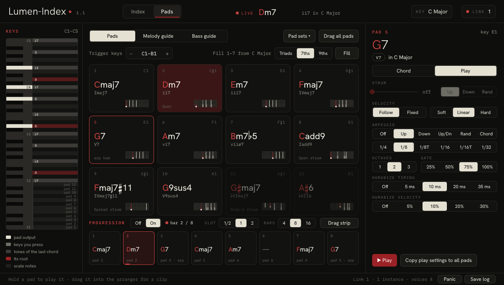
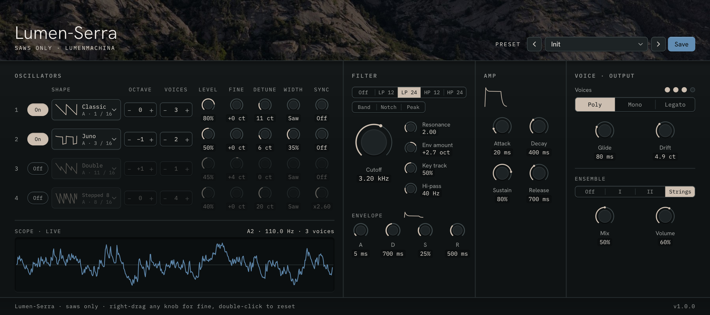
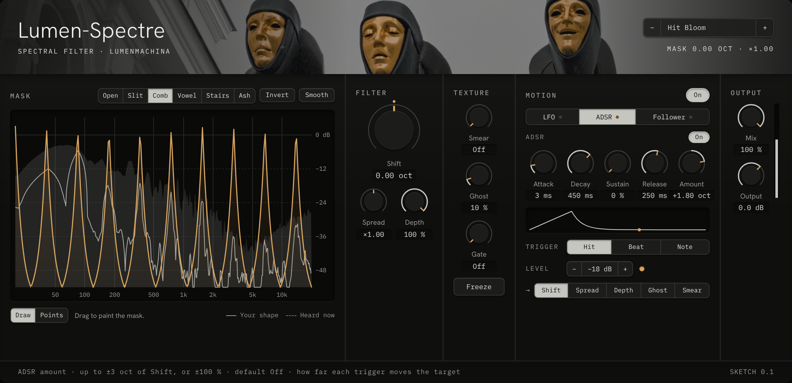

# Lumen

**Audio plugins by [Lumen-Machina](https://lumen-machina.com).** Instruments, effects and tools for making worn, warm, hazy electronic music, built first for Bitwig Studio and also running in Logic and other hosts on Windows and Mac.

Every plugin takes its look from one of Lumen-Machina's photographs: its colors, its textures and its mood. The photo is credited inside each plugin.

## The plugins

| Plugin | What it is | Status |
|---|---|---|
| **[Lumen-Index](plugins/lumen-index.md)** | A chord and scale companion: find any chord or scale by name or by the notes you play, put chords on 12 pads with borrowed chords and smooth voice leading, read the chords of a clip or MIDI file, run a progression in time with your song, catch what you play over it, and drag it all into your arrangement as MIDI. Also a standalone app for MIDI keyboards and hardware synths. | **Released** (1.4) |
| **Lumen-Haze** | A tape-worn polysynth for soft pads, fuzzy leads and shoegaze walls. | Early demo, not planned for release |
| **Lumen-Oxide** | A tape machine effect: saturation, wow, flutter, hiss and wear, with five tape types (Ferric, Chrome, Reel, VHS, Micro) and three tape speeds. For single tracks, drum buses or a whole mix. | Parked (0.1) |
| **[Lumen-Serra](plugins/lumen-serra.md)** | A synth built only from saw waves: 32 saw shapes in two banks, four drifting unison stacks, saw-made pulse width, hard sync, eight filter types, eight-note polyphony and a string-machine ensemble. 36 presets. | **Released** (1.1, early) |
| **[Lumen-Spectre](plugins/lumen-spectre.md)** | A spectral filter: draw a Mask across a thousand thin frequency bands, or build it from points, curves, steps and saws, then shift, smear, freeze and whisper it, moved by an LFO, an ADSR or the sound itself. | In development (1.0 soon) |

## Lumen-Index

Find chords and scales by name or by the notes you play, and put them on 12 pads with smooth voice leading and hints for what comes next. Run a progression in time with your song, read the chords out of a clip or MIDI file, catch the line you play over them, and drag it all into your arrangement. For Bitwig, Logic, GarageBand and MainStage, and as a standalone app for hardware.

New in 1.4: Read chords from a clip as it plays or from a dropped MIDI file; Undo and Redo, 32 steps deep, for the pads, the progression and the key; scales that play as you browse; slash chords that keep their bass on the pads; and dragged clips timed at your song's tempo with no tempo prompt in Bitwig.

**[See everything Lumen-Index does →](plugins/lumen-index.md)** · **[Get it on Gumroad →](https://lumenmachina.gumroad.com/l/lumen-index)** · [User guide](plugins/lumen-index-guide.md)

## Lumen-Serra

Thirty-two saws, including a bank of hollow bipolar saws, stacked four deep on four oscillators, reshaped with Width and Sync, through eight filter types and a string ensemble. **[See everything Lumen-Serra does →](plugins/lumen-serra.md)** · **[Get it on Gumroad →](https://lumenmachina.gumroad.com/l/lumen-serra)** · [User guide](plugins/lumen-serra-guide.md)

## Lumen-Spectre

A spectral filter. Draw a Mask across the spectrum, or build it from points joined by curves, steps and saws, then slide it, smear it, freeze it and scatter it into a whisper, moved by an LFO, an ADSR or the sound itself. In development. **[See what Lumen-Spectre does →](plugins/lumen-spectre.md)**

## Formats

| | Windows | Mac (Intel and Apple Silicon) |
|---|---|---|
| CLAP (Bitwig Studio and other CLAP hosts) | ✓ | ✓ |
| Audio Unit (Logic Pro) | | ✓ |
| Standalone app | Lumen-Index | Lumen-Index |

Lumen-Serra is CLAP on Windows and Mac, and an Audio Unit instrument on Mac.

Formats for the plugins in development are settled when each one is released.

## Getting the plugins

- **Lumen-Index:** [get it on Gumroad](https://lumenmachina.gumroad.com/l/lumen-index), pay what you want.
- **Lumen-Serra:** [get it on Gumroad](https://lumenmachina.gumroad.com/l/lumen-serra), pay what you want.
- **Lumen-Spectre:** in development.
- The other plugins will be listed here as each one is released.

## Feedback

Found a problem or have an idea? [Open an issue](../../issues/new/choose) and pick the plugin it is about. This is the one place for feedback on every Lumen plugin.

## More

- [Roadmap](ROADMAP.md): what is coming and in what order.
- [Design language](docs/design-language.md): how the photographs become the interfaces.

---

© 2026 Lumen-Machina. All rights reserved. The plugins' source code is not public.
