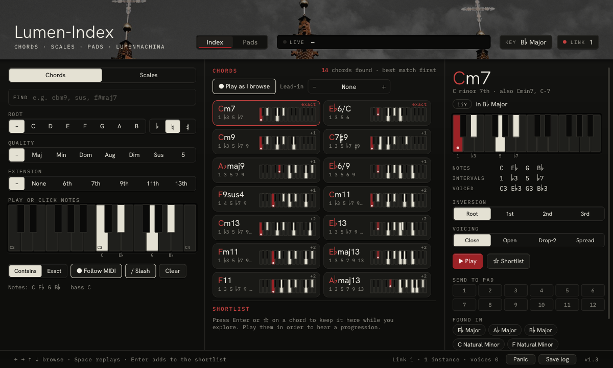
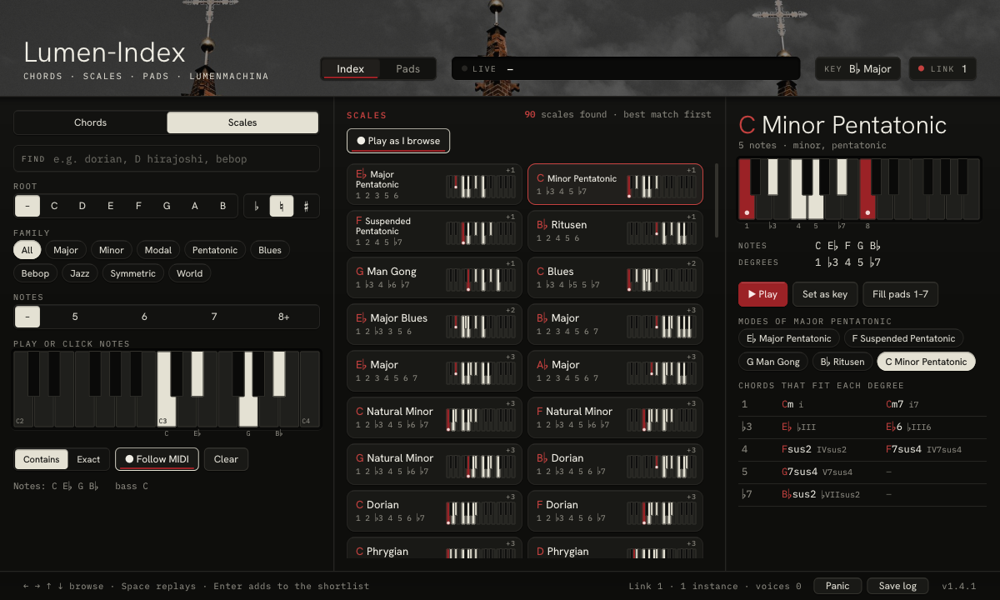
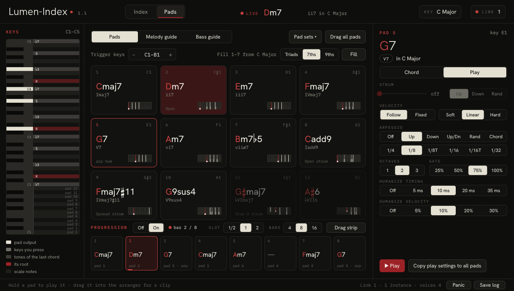
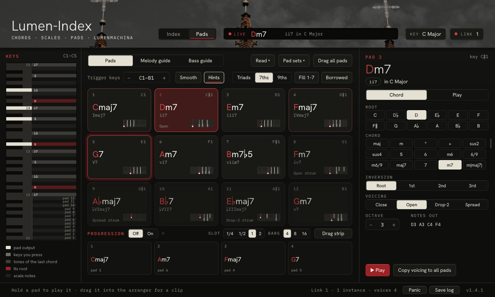
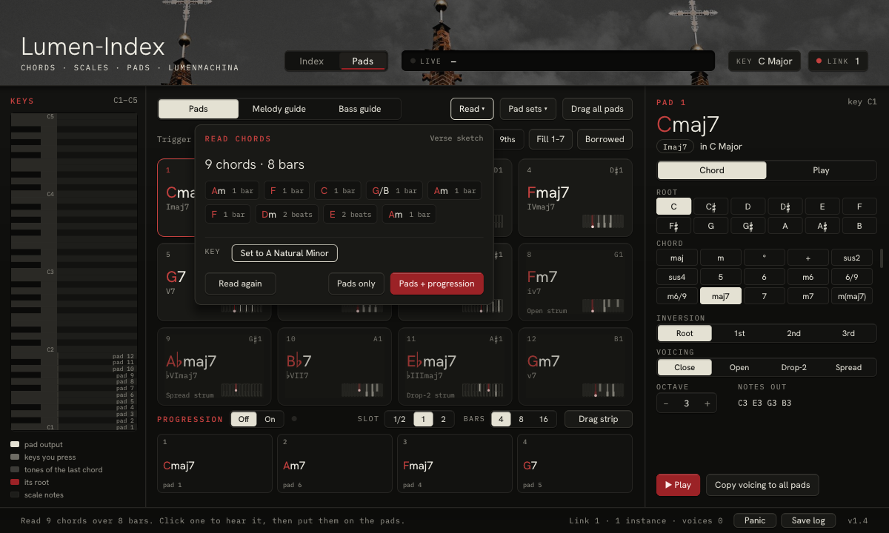
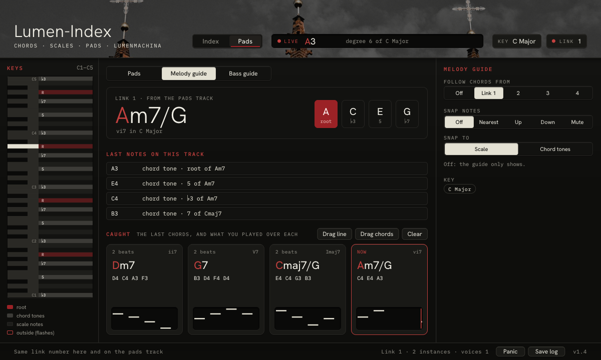

# Lumen-Index 1.4 user guide

*This is the guide for Lumen-Index version 1.4. See [what's new in 1.4](lumen-index.md#whats-new-in-14), or go back to the [Lumen-Index page](lumen-index.md).*

Lumen-Index is a chord and scale companion by [Lumen-Machina](https://lumen-machina.com). This guide covers every control in version 1.4, in the plugin and in the standalone apps.

## Contents

1. [What Lumen-Index is](#what-lumen-index-is)
2. [Install](#install)
3. [A first 10 minutes](#a-first-10-minutes)
4. [The window](#the-window)
5. [Index page: Chords and Scales](#index-page-chords-and-scales)
6. [Pads page](#pads-page)
7. [Progression](#progression)
8. [Read chords](#read-chords)
9. [Melody guide and Bass guide](#melody-guide-and-bass-guide)
10. [Link](#link)
11. [Getting it into your song](#getting-it-into-your-song)
12. [Standalone apps](#standalone-apps)
13. [Saving and pad set files](#saving-and-pad-set-files)
14. [Troubleshooting and Save log](#troubleshooting-and-save-log)
15. [Reference](#reference)

---

## What Lumen-Index is

Lumen-Index sits in front of an instrument and works with MIDI notes. It makes no sound of its own: it sends notes on to the synth after it. With it you can:

- **Find** any chord or scale by name, or by the notes you play.
- **Play chords on 12 pads** from one octave of your keyboard, with strums, arpeggios and smooth voice leading.
- **Run a progression** of those pads in time with your song.
- **Read the chords** of a clip or a MIDI file and put them on the pads.
- **Guide a melody or bass track**: another copy of Lumen-Index shows the chord the pads track is playing and checks what you play over it.
- **Drag** pads, chords, progressions and the lines you played straight into your song as MIDI clips.

### Formats and where it runs

| | Windows | Mac (Intel and Apple Silicon, macOS 10.13 or later) |
|---|---|---|
| **Bitwig Studio** or any CLAP host | `Lumen-Index.clap` | `Lumen-Index.clap` |
| **Logic Pro, GarageBand, MainStage** | | `Lumen-Index.component` (Audio Unit, goes in the **MIDI FX** slot) |
| **Standalone**, for MIDI keyboards and hardware synths | `Lumen-Index.exe` | `Lumen-Index.app` |

The window and the note engine are the same in every format. The standalone apps add MIDI device menus to the footer (see [Standalone apps](#standalone-apps)).

### A note on note names

Note names follow Bitwig's numbering, where middle C (MIDI note 60) is **C3**. So the default trigger keys, C1–B1, are MIDI notes 36–47. If your host numbers octaves differently, go by the note numbers.

---

## Install

Download the Windows or Mac zip from [Gumroad](https://lumenmachina.gumroad.com/l/lumen-index) (pay what you want).

| Download | What's inside |
|---|---|
| Windows zip | `Lumen-Index.clap`, `Lumen-Index.exe`, `README.txt` (the manual), `licences/` |
| Mac zip | `Lumen-Index.clap`, `Lumen-Index.component`, `Lumen-Index.app`, `README-mac.txt`, `README.txt` (the manual), `licences/` |

### Windows

1. Copy `Lumen-Index.clap` to `C:\Program Files\Common Files\CLAP\`.
2. If you have an old `Lumen Index.clap` (version 0.2.x, with a space in the name) in that folder, remove it. Projects made with 0.2.x still open with 1.4.
3. Rescan plug-ins in Bitwig.
4. For the standalone app, put `Lumen-Index.exe` wherever you like and run it.

The files aren't code-signed yet, so Windows may warn about an unknown publisher the first time.

### Mac

1. Copy the files you want:
   - **CLAP** (Bitwig): `Lumen-Index.clap` to `~/Library/Audio/Plug-Ins/CLAP/`
   - **Audio Unit** (Logic, GarageBand, MainStage): `Lumen-Index.component` to `~/Library/Audio/Plug-Ins/Components/`
   - **App**: drag `Lumen-Index.app` into Applications.

   In Finder, use **Go > Go to Folder…** and paste the path. Make the folder if it's missing.
2. The builds aren't signed with an Apple developer account yet, so macOS blocks them at first. `README-mac.txt` in the download has the Terminal commands that clear this. Open Terminal and run, once, the line for each file you installed:

   ```
   xattr -dr com.apple.quarantine /Applications/Lumen-Index.app
   xattr -dr com.apple.quarantine ~/Library/Audio/Plug-Ins/Components/Lumen-Index.component
   xattr -dr com.apple.quarantine ~/Library/Audio/Plug-Ins/CLAP/Lumen-Index.clap
   ```
3. Restart Logic or Bitwig.

### Loading it in Bitwig

1. Make an instrument track with the synth you want to play.
2. Add Lumen-Index **first** on the track, before the instrument. It's a note effect, so it passes notes on to the device after it.
3. Open its window.

Every parameter can be automated (see [Parameters the host can automate](#parameters-the-host-can-automate)).

### Loading it in Logic Pro (also GarageBand, MainStage)

1. Make a Software Instrument track (or an External MIDI track for hardware).
2. Click the **MIDI FX** slot above the instrument and choose **Audio Units > Lumen-Machina > Lumen-Index**.
3. Play C1–B1 to trigger the pads. Everything else passes through.

If it doesn't appear, open **Logic Pro > Settings > Plug-in Manager**, find Lumen-Index and click **Reset & Rescan Selection**.

---

## A first 10 minutes

This walkthrough uses Bitwig. You'll need a MIDI keyboard, or you can click the pads with the mouse.

**1. Load it and set the key**

1. Put Lumen-Index first on an instrument track (in Logic, in the MIDI FX slot) and open its window.
2. Click **KEY** in the header. Pick a root, then a scale, for example **A** and **Natural Minor**. Click outside the menu to close it.

**2. Fill the pads**

1. Click **Pads** in the header if it isn't already showing.
2. Pick **7ths** (the default), then click **Fill 1–7**. Pads 1–7 now hold the seven chords of your key.
3. Click **Borrowed**. Pads 8–12 get chords from the parallel key (the major or minor key on the same root), which add colour.

**3. Play the pads**

1. Play C1 to B1 on your keyboard, black keys included: each key plays one pad. Or click and hold a pad.
2. Turn on **Smooth**. Each chord now picks the inversion closest to the one before it, so the notes move as little as possible.
3. **Hints** is on by default. After a pad plays, the pads that usually come next glow: bright red for the usual next chords, a dim red edge for other common ones, a pale glow for a twist that works.
4. Watch the **LIVE** display in the header: it names each chord and where it sits in your key.

**4. Build a progression**

A new instance already has four slots set to pads 1, 6, 4 and 5 (I, vi, IV, V). To make your own:

1. Under the pads, click the first slot of **PROGRESSION**. It lights up.
2. Click four pads in the order you want. Each fills the next slot.
3. Press **Esc** to stop filling.
4. Click **On**, then press play in Bitwig. The progression plays while the transport runs, in time with the song.

**5. Add a guide track**

1. Make a second instrument track (a lead or bass sound) and add Lumen-Index first on it.
2. In its window, on the **Pads** page, set the role switch at the top to **Melody guide** (or **Bass guide**).
3. Both instances start on link 1, so the guide already follows the pads track. The header's **LINK** chip shows the number.
4. Play along while the progression runs. The guide shows the current chord, lights its tones on the keyboard, and labels each note you play as a chord tone, a scale note or outside the key.

**6. Look at Caught**

On the guide track, the **CAUGHT** row keeps the last four chords, each with the notes you played over it. Click a card to hear its chord.

**7. Drag into the arranger**

1. Drag a **Caught** card onto the arranger: you get a clip of the line you played over that chord.
2. On the pads track, drag **Drag strip** onto the arranger: you get the whole progression as a clip, with strums and arpeggios included.
3. Drag any single pad out for one bar of its chord.

**8. Read chords from a clip**

1. On the pads track, click **Read ▾**.
2. Drop a MIDI file on the window (or click **Open file…**), or press **● Read** and play a clip on the same track.
3. When the result shows, click **Pads + progression**.
4. Turn the progression **On** (Read doesn't do this for you) and press play.

That's the core of it. The rest of this guide covers each part in full.

---

## The window

The window is the same in the plugin and both apps. It's a fixed size (1200 × 720) and can't be resized; the host or the operating system scales it.

### Header

- **Page tabs: Index and Pads.** **Index** is the chord and scale dictionary. **Pads** holds the pads, the progression, Read and, in a guide role, the guide.
- **LIVE**: names whatever this instance is sending out, or, if nothing is going out, the keys you're holding. The dot next to it lights red while something sounds.
  - Two or more notes that make a known chord: the chord name (root in red), then its Roman numeral and whether it's in your key, for example "ii7 in C Major". The numeral shows where the chord sits in the key: ii7 is the minor 7th built on the 2nd degree.
  - One note: its name and its degree, for example "degree 6 of C Major", or "outside C Major" for a note that isn't in the key.
  - Three or more notes that make no known chord: up to 6 note names.
  - Nothing sounding: "–".
- **KEY**: shows the current key, for example "KEY C Major". Click to open the [KEY menu](#key-menu).
- **LINK**: shows "LINK Off" or "LINK 1" to "LINK 4", with a red dot when on. Click for the next value (Off → 1 → 2 → 3 → 4 → Off); right-click for the one before. On a Mac, Control-click counts as a right-click. See [Link](#link).

### KEY menu

- **KEY ROOT**: the 12 roots.
- **♭ Flats / ♯ Sharps**: how a black-key root is spelt (B♭ Major or A♯ Major). Every other note follows the key: notes outside the key are spelt with flats only if the key itself has a flat, so in C Major they come out as sharps (G♯, A♯) whichever you pick. Default: Flats.
- **SCALE**: the 16 common scales: Major, Dorian, Phrygian, Lydian, Mixolydian, Natural Minor, Harmonic Minor, Phrygian Dominant, Melodic Minor, Major Pentatonic, Minor Pentatonic, Blues, Major Blues, Whole Tone, Diminished (whole-half), Diminished (half-whole).
- **All scales**: opens the Index in Scales mode, where any of the 56 scales can be made the key with **Set as key**.

The default key is C Major with flats. The key decides how notes are spelt, the Roman numerals, which pads are dimmed as out of key, what **Fill 1–7** and **Borrowed** put on the pads, the Hints, and what Snap treats as the scale. Linked instances share the key.

### Footer

- **Status text**: the last message, for example "Sent Cmaj7 (Root, Close) to pad 3." The message stays until the next one. Until the first message, it shows a hint for the page (and while you fill progression slots, it shows the filling hint instead of any message):
  - Index: "← → ↑ ↓ browse · Space replays · Enter adds to the shortlist"
  - Pads: "Hold a pad to play it · drag it into the arranger for a clip"
  - While filling progression slots: "Click pads to fill the progression in order · Esc stops"
  - Guides: "Same link number here and on the pads track"
- **Link and voices**: "Link 1 · 2 instances · voices 3", or "Link off · voices 0". The instance count includes every running Lumen-Index the link can see, not only the ones on your link number.
- **Panic**: stops every sound Lumen-Index is making and sends "all notes off". Use it for stuck notes. Status: "Panic: every voice ended."
- **Save log**: writes a diagnostic file to your desktop. See [Save log](#save-log).
- The version, **v1.4**.
- In the standalone apps only: **MIDI IN**, **MIDI OUT** and **CH** (see [Standalone apps](#standalone-apps)).

### Mouse and keyboard in general

- The mouse wheel or trackpad scrolls the results, the detail panel, the KEY menu's scale list, the Pad sets list and the pad editor's chord grid. You can also drag the results scrollbar.
- A double-click works like a single click.
- **Esc** closes an open menu, or stops filling progression slots. Clicking outside a menu also closes it.
- On a Mac, keys the window doesn't use, and any key with Command, go on to the host, so its transport shortcuts still work.

---

## Index page: Chords and Scales



*The Index in B♭ major with C, E♭, G and B♭ selected. Cm7 is picked, showing its notes, intervals, inversion and voicing, and the scales it's found in.*

The Index is a dictionary of 492 chords (41 chord types on 12 roots) and 672 scales (56 scales on 12 roots). Switch between them with **Chords / Scales** at the top of the left column. Switching clears the FIND text.

The page has three columns: what you're looking for on the left, the results in the middle, and the details of the selected result on the right.

### FIND

Click the **FIND** field and type a chord or scale name. Press Enter, Esc or Tab to leave the field. Typing a name clears any selected notes.

**Chords**: type a root and a chord symbol, or just the symbol.

| You type | You get |
|---|---|
| `ebm9` | E♭ minor 9th |
| `sus` | every sus chord on every root |
| `maj7` | major 7th chords on all 12 roots first, then maj7♯11 and +maj7 |
| `bbmaj7` | B♭ major 7th |
| `am7` | A minor 7th |
| `dim`, `add9`, `aug`, `alt` | those chords, and the chords whose names start with them, on every root (`dim` also brings up m7♭5 and °7). These words are read as chord names, not as a root |
| `half`, `quartal` | words from the long names work too (half-diminished, quartal) |
| `c` | every chord on C (a single letter is always a root) |

Roots work in lowercase or capitals. Use `b` for flat and `#` for sharp. The chord that matches what you typed exactly comes first; chords whose names start with it follow.

> **Bitwig may keep Shift from plug-in windows,** so type in lowercase: `ebm9`, `f#maj7`. If `#` won't type (it needs Shift on most keyboards), pick the root with the **ROOT** filter (for example **F** and **♯**) and type just the rest (`maj7`) in FIND.

**Scales**: type a scale name, a family, or a root and a name.

| You type | You get |
|---|---|
| `dorian` | Dorian on your key's root |
| `d hirajoshi` | Hirajoshi on D |
| `bebop` | the bebop scales |
| `pentatonic`, `blues` | scales in that family |

Other names work as search words too, among them Ionian, Aeolian, Hijaz, Freygish, Jazz Minor, Super-Locrian, Octatonic, Sakura, Byzantine and Gypsy Minor.

### Filters

- **ROOT**: **–** (any) or a letter C to B, plus **♭ ♮ ♯** to make it flat, natural or sharp.
- Chords only:
  - **QUALITY**: – Maj Min Dom Aug Dim Sus 5 (5 is the power chord).
  - **EXTENSION**: – None 6th 7th 9th 11th 13th.
- Scales only:
  - **FAMILY**: All, Major, Minor, Modal, Pentatonic, Blues, Bebop, Jazz, Symmetric, World.
  - **NOTES**: – 5 6 7 8+ (how many notes the scale has).

### Finding a chord by its notes

The **PLAY OR CLICK NOTES** keyboard covers two octaves, C2 to C4.

- **Click** keys to turn them on or off. A key you turn on plays briefly. Selected keys show their names.
- **Play** notes on your MIDI keyboard. With **● Follow MIDI** on (the default), each new note you play replaces the selection with all the keys you're holding, in any octave, and clears FIND. This only happens while the Index page is showing. Click it to switch to **○ Follow MIDI** (off).

Below the keyboard, a line shows your selection, for example "Notes: C E G   bass C", or "No notes selected: showing everything that matches the filters."

- **Contains / Exact**: **Contains** lists every chord or scale that holds all your notes. **Exact** lists only the ones made of exactly those notes (plus "no 5" matches, below).
- **/ Slash** (Chords, on by default): when your lowest note isn't the chord's root, the result is named as a slash chord. A slash chord is a chord over a different bass note: C/E is C major with E in the bass. This applies to exact and "no 5" matches.
- **Clear**: clears the notes, every filter and FIND. It leaves Contains/Exact, Follow MIDI and Slash as they are.

### Results

The middle column shows "N chords found · best match first" (the "best match first" part appears when notes are selected). Each tile shows the name (root in red), its degrees, a mini keyboard, and a tag:

| Tag | Meaning |
|---|---|
| **exact** | made of exactly the notes you selected |
| **no 5** | exact apart from a missing 5th (only for chords of 4 or more notes, with at least 3 notes selected); players often leave the 5th out |
| **+N** | the chord has N notes you didn't select |

Results are ordered by: name match, then how well they match your notes, then whether your bass note is the root, then how common the chord is, then fewest notes, then by root, counting up from your key's root (in C: C, C♯, D… B).

With no notes selected, Chords lists every chord the filters allow. Scales, with no notes and no root, lists the scales on your key's root; with a root, that root; with notes, every root and scale that contains them.

If nothing matches: "Nothing matches. Try Contains, or clear a filter."

- **Click a tile** to select it. A chord tile also plays; to hear a scale, use **▶ Play** in the right column.
- **Drag a chord tile** into your DAW for a one-bar clip (see [Getting it into your song](#getting-it-into-your-song)).

### Browsing with the keys

When FIND isn't taking your typing:

| Key | Does |
|---|---|
| ← / → | previous / next result |
| ↑ / ↓ | up / down one row (2 results) |
| PgUp / PgDn | 12 results back / on |
| Space | replay the selected chord (Chords only) |
| Enter | add the chord to the shortlist, or take it out if it's already there |

**● Play as I browse** (Chords, on by default) plays each result as you move to it with the arrow keys.

### Lead-in

**Lead-in** (Chords, with − / + buttons) plays one of your pads before each candidate, so you hear every chord coming from the chord before it. The values are None, then "Pad 1 · Cmaj7" through "Pad 12".

With a lead-in, each audition plays the pad, a short gap, then the candidate. Without one, the candidate plays on its own.

### Chord details

The right column shows the selected chord:

- The name, large, with its long name and other ways of writing it, for example "C major 7th · also CΔ7, CM7, CΔ".
- A Roman-numeral pill and "in C Major", or, for a chord with notes outside the key, "borrowed: A♭ not in key".
- A keyboard with the notes labelled by degree.
- **NOTES**, **INTERVALS** and **VOICED** (with octave numbers, for example "C3 E3 G3").
- **INVERSION**: **Root / 1st / 2nd / 3rd**. An inversion puts a different chord note at the bottom: 1st inversion has the 3rd lowest, 2nd the 5th. At most four buttons are shown, even for 5- and 6-note chords.
- **VOICING**: **Close / Open / Drop-2 / Spread** (explained under [Chord tab](#chord-tab)). Changing the inversion or voicing plays the chord again.
- **▶ Play** plays it. Index chords play around C3, at velocity 0.75, through your instrument.
- **☆ Shortlist / ★ In shortlist** adds it to the shortlist, or takes it out.
- **SEND TO PAD 1–12** puts this chord on that pad: root, spelling, chord type, and the inversion and voicing you picked. The pad keeps its octave and play settings. Status: "Sent Cmaj7 (Root, Close) to pad 3." There's no Undo for this. A slash chord's bass note isn't sent (the status still names the slash chord): to keep that note at the bottom, pick the inversion that puts it there before you send.
- **FOUND IN**: up to six common 7-note scales that contain the chord. Click one to jump to that scale in Scales mode.

### Shortlist

The **SHORTLIST** (Chords only) keeps up to 24 chords while you explore. Each keeps the inversion and voicing it was added with.

- Add a chord with **☆ Shortlist** or Enter.
- Click a chip to hear it. Click its **×** to remove it.
- **▶ Play in order** (shown with 2 or more chips) plays them one a second, so you can hear them as a progression.
- **Drag as clip**: drag it into your DAW for one bar per chord.
- Drag a single chip out for that chord alone.

The shortlist is saved with the project.

### Scales view



*The Scales view with the same four notes: 90 scales contain them. C Minor Pentatonic is picked, showing its modes and the chords on each degree.*

The right column shows the selected scale:

- The root (in red) and name, with "also …" names, the number of notes and its families.
- A keyboard labelled with degrees (the octave shows as "8").
- **NOTES** and **DEGREES**. For Melodic Minor, also **DESCENDING**: the natural minor, read downward, as it's traditionally played going down.
- **▶ Play** plays the scale going up, with the octave on top. For scales of more than 7 notes (bebop, diminished and so on), it plays the first 7 notes, then the octave.
- **Set as key** makes it your key, choosing flats or sharps from the root's spelling. Status: "Key set to D Dorian. Shared with linked instances."
- **Fill pads 1–7** fills pads 1–7 from this scale at the size chosen on the Pads page (Triads, 7ths or 9ths). Unlike **Fill 1–7** on the Pads page, this one has no Undo.
- **MODES OF …** (for scales in the Major, Harmonic minor, Melodic minor and Major pentatonic families): each mode, shown on the root that shares this scale's notes. A mode is the same set of notes started from a different degree: D Dorian has the notes of C Major. Click one to go to it.
- **CHORDS ON EACH DEGREE** (7-note scales): a triad and a 7th on each degree, built by stacking thirds. For other scales, **CHORDS THAT FIT EACH DEGREE**: the most common triad and 4-note chord that fit. Each shows its numeral. Click one to hear it.

---

## Pads page



*The Pads page in C major with Smooth and Hints on. The 8-bar progression is at bar 5 (Am7), and Dm7 and Fmaj7 glow as usual next chords. Pad 5 (G7) is open on its Play tab, with an arpeggio set to Up, 1/8, 2 octaves.*

### Role

The switch at the top of the Pads page sets what this instance does: **Pads** (the default), **Melody guide** or **Bass guide**. This section covers Pads. For the guides, see [Melody guide and Bass guide](#melody-guide-and-bass-guide).

### The KEYS C1–C5 keyboard

The vertical keyboard on the left runs from C1 to C5. It lights the keys being sent out, the keys you're pressing, the scale notes, and the tones of the last chord (its root marked "R" in red). The trigger keys are marked "pad 1" to "pad 12" when they fall inside C1–C5. Click a key to hear that note.

### Trigger keys

The 12 keys of one octave, black keys included, play pads 1–12. **Trigger keys** sets which octave, from "C-1–B-1" to "C7–B7". The default is **C1–B1**.

Every key outside the trigger octave passes through to your instrument as normal, with Snap applied if Snap is on (see [Snap](#snap)).

The trigger octave only decides which keys play the pads. The octave each pad sounds in is set per pad in the editor.

### The 12 pads

The pads sit in a 4 × 3 grid. Each card shows:

- the pad number and its trigger key (always spelt with sharps, for example "C♯1");
- the chord name and its numeral;
- only the settings that aren't the default ("1st", "Open", "arp", "strum", "hum" and so on);
- a mini keyboard of its notes.

Pads with notes outside the key are dimmed, but still play. Borrowed chords are dimmed less. The selected pad has a red edge, and a pad flashes when it plays.

- **Click and hold** a pad to play it (at velocity 0.8) and open it in the editor on the right.
- **Drag** a pad (move more than a few pixels while holding) to drag it out as a clip. The pad stops playing when the drag starts.
- **Play it from your keyboard**: velocity follows the pad's Velocity setting. A pad played from a key goes out on the MIDI channel the key came in on, unless **Output channel** is set (see [Parameters](#parameters-the-host-can-automate)). A note that's already sounding isn't started twice.

A new instance starts with these pads:

| Pad | Chord | Notes |
|---|---|---|
| 1–7 | Cmaj7, Dm7, Em7, Fmaj7, G7, Am7, Bm7♭5 | the 7th chords of C major, octave 3 (pad 1 = C3 E3 G3 B3) |
| 8 | Cadd9 | Open voicing, 60 ms strum |
| 9 | Fmaj7♯11 | Spread voicing, 120 ms strum |
| 10 | G9sus4 | |
| 11 | G♯maj7 | Drop-2 voicing, 30 ms strum |
| 12 | A♯6 | |

Pads 11 and 12 hold the ♭VI and ♭VII chords. They're spelt from the key, and C Major spells notes outside it with sharps, so they show as G♯maj7 and A♯6. **Borrowed** spells the chords it puts on pads 8–12 with flats (A♭maj7, B♭7), as in the screenshots.

### Fill 1–7, Triads / 7ths / 9ths

1. Choose a size: **Triads**, **7ths** (the default) or **9ths**.
2. Click **Fill 1–7**. Pads 1–7 get the chords of your key at that size. For 7-note scales they're built by stacking thirds.

- Where a degree has no 9th chord, it uses the 7th (or the triad).
- Scales with fewer than 7 notes fill only that many pads.
- Each filled pad is reset to root position and spelt from the key. It keeps its voicing, octave and play settings.
- Pads 8–12 are kept.
- It can be undone: status "Pads 1–7 filled from the key. Pads 8–12 kept. Pad sets ▾ has Undo."

### Borrowed

A borrowed chord comes from the parallel key: the key on the same root with the other quality (C minor if you're in C major, A major if you're in A minor). Borrowed chords give a lot of bittersweet and shoegaze progressions their colour.

**Borrowed** fills pads 8–12 with up to five chords from the parallel key that aren't already in your key, at the size chosen for Fill:

| Your key | Chords, in this order |
|---|---|
| Major-type | iv, ♭VI, ♭VII, ♭III, v, then ♭II, ii° |
| Minor-type | V, IV, I, ii, ♭II, then iii, vi |

- Triads give triads; 7ths give m7, maj7 or 7 (and ii° becomes m7♭5); 9ths give m9, maj9 or 9 (ii° stays m7♭5).
- The chords are spelt properly (A♭, not G♯, in C). In C major with 7ths you get Fm7, A♭maj7, B♭7, E♭maj7 and Gm7.
- It can be undone: status "Pads 8–12 borrowed from the parallel minor: … Pad sets ▾ has Undo."
- If there's nothing to borrow: "This key has no borrowed chords that aren't already in it."

### Smooth

Voice leading means moving each note of one chord to a nearby note of the next, the way a keyboard player's hands move, instead of jumping the whole shape. **Smooth** (off by default) does this for you.

With Smooth on, each pad you play, from a key, a click or the progression, picks the inversion and octave (the pad's own, one up or one down) whose notes move least from the chord played just before. C to F, for example, keeps the C and moves E and G up a step.

- It prefers to stay within a fourth of the pad's own register, and the middle of the chord never moves more than a major sixth (9 semitones) from it.
- The first chord plays as voiced.
- "Just before" means the last pad this instance played, whatever played it.
- It also applies inside **Drag all pads** and **Drag strip**.

Smooth is saved with the project.

### Hints

**Hints** (on by default) lights up, after a pad plays, the pads that usually come next:

| Glow | Meaning |
|---|---|
| **Bright red** | the usual next chords (all of them) |
| **Dim red edge** | common choices (at most 2) |
| **Pale glow** | a twist that works, such as a borrowed chord or a deceptive move (at most 1) |

Pads holding the same chord as the one just played are skipped. Major and minor keys have their own tables. For a chord the tables don't cover, the hint goes by how the root moves: down a fifth is strong; up a step, or down a third, is good.

Hints need a pad to have been played first. The setting is saved with the project.

### The pad editor



*Pad 2 (Dm7, Open voicing) held. The Chord tab shows its root, chord type, inversion, voicing, octave and the notes it sends out (D3 A3 C4 F4). G7 glows as the usual next chord.*

The right column edits the selected pad. Its header shows "PAD n", its trigger key, the chord name, a numeral pill, and "in C Major" or "out of key". It has two tabs, **Chord** and **Play**; the open tab is saved with the project.

There's no Undo for edits in the pad editor.

#### Chord tab

Every change plays the pad briefly, with its strum.

- **ROOT**: 12 buttons, spelt from the key. Choosing a root resets the spelling to the key's.
- **CHORD**: a scrolling grid of all 41 chord types, by symbol ("maj" for major).
- **INVERSION**: **Root / 1st / 2nd / 3rd**.
- **VOICING**: how the notes are spread out. Voicings apply to chords of 3 or more notes.

  | Voicing | What it does |
  |---|---|
  | **Close** | the notes stacked as tightly as they come |
  | **Open** | the second note up an octave |
  | **Drop-2** | the second note from the top down an octave: a wider shape common in jazz piano and guitar |
  | **Spread** | the lowest note down an octave and, with 4 or more notes, the third note up an octave |

- **OCTAVE**: 0 to 6, default 3. Octave 3 puts the root at C3 (middle C).
- **NOTES OUT**: the notes the pad will play.

#### Play tab

- **STRUM**: from 0 ("off") to 250 ms, with a direction: **Up** (lowest note first), **Down** (highest first) or **Rand**. The strum time is spread evenly from the first note to the last. Strum is dimmed while an arpeggio is on.
- **VELOCITY**:
  - **Follow** (default) follows how hard you play, through a curve: **Soft** (light playing comes out louder), **Linear** (default, as played) or **Hard** (you have to play harder for loud notes).
  - **Fixed** plays every note at one velocity, from 1 to 127 (default 100).
- **ARPEGGIO**: plays the chord one note at a time while the pad is held.

  | Mode | Plays |
  |---|---|
  | **Off** | the chord (default) |
  | **Up** | low to high |
  | **Down** | high to low |
  | **Up/Dn** | up then down, without repeating the top and bottom notes |
  | **Rand** | random order, never the same note twice in a row |
  | **Chord** | the whole chord, unstrummed, on every step |

  - Rate: **1/4**, **1/8**, **1/8T**, **1/16** (default), **1/16T**, **1/32** (T is triplet).
  - **OCTAVES**: 1 (default), 2 or 3. The notes repeat up over that many octaves (at most 24 notes). In Chord mode this reads "OCTAVES (NOT USED)".
  - **GATE**: 25%, 50%, 75% (default) or 100%: how much of each step the note lasts.
  - It runs at the song tempo (120 bpm if the host gives none). While the transport runs, it locks to the song's grid: the first step plays when you press, and the next lands on the next grid line (or the one after, if the next is less than half a step away).
- **HUMANIZE TIMING**: **Off**, **5 ms**, **10 ms**, **20 ms** or **35 ms**. Each note, or arpeggio step, comes up to that much late, at random.
- **HUMANIZE VELOCITY**: **Off**, **5%**, **10%**, **20%** or **30%**. Each note's velocity varies by up to that much, up or down.

Humanize works on chords, strums and arpeggios.

#### Buttons under the editor

- **▶ Play** plays the selected pad while you hold the mouse.
- On the Chord tab, **Copy voicing to all pads** copies only the voicing to the other 11 pads. It doesn't copy the root, chord, inversion or octave. Status: "Voicing copied to all pads."
- On the Play tab, **Copy play settings to all pads** copies the whole Play tab to the other 11 pads: strum and its direction, velocity mode, value and curve, arpeggio mode, rate, octaves and gate, and both humanize settings. Status: "Strum, velocity, arpeggio and humanize copied to all pads."

### Pad sets and Undo

A pad set saves all 12 pads, with every Chord and Play setting, plus the progression (its slots, slot length and loop length). It doesn't save the progression's On/Off, Smooth, Hints, the key or the shortlist. Pad sets are shared by every project on the computer.

Click **Pad sets ▾** to open **PAD SETS**. When a set is loaded, the button shows its name instead.

**To save a set**

1. Type a name in the field ("Name this set"). If a set is loaded, its name is already there.
2. Click **Save**, or press Enter. If the name exists, the button reads **Replace** and overwrites it.

Names can use plain letters, digits, spaces and `- _ . ( ) ' # & + ,`, up to 39 characters. Other characters are dropped. Status: "Saved pad set "lo-fi keys"." With no name: "Type a name for the set first."

**To load a set**, click its name in the list (sorted A–Z; the loaded set has a red dot). Status: "Loaded pad set "X". Pad sets ▾ has Undo." Loading a set from 1.0.5–1.0.7, which had no progression, keeps your current progression.

**To delete a set**, click its **×**, then **Delete** to confirm.

In the name field, Enter saves, Esc closes the menu and Tab leaves the field.

#### Undo

When there's something to undo, the bottom of the menu shows **Undo (back to <previous set name>)** or **Undo (back to the pads before)**. Click it to put the pads back. Status: "Pads put back as they were before the load."

| Undo covers | Undo doesn't cover |
|---|---|
| loading a pad set | **Fill pads 1–7** on the Index's Scales view |
| **Fill 1–7** on the Pads page | **Send to pad** |
| **Borrowed** | edits in the pad editor |
| **Read → Pads only** and **Pads + progression** | a key change (from Read's **Set to <key>** or anywhere else) |

- There's one level of Undo: only the last of these actions.
- It puts back the pads and the progression, but leaves the progression's On/Off as it is now.
- Undo isn't saved with the project, and it lives in the open window: closing the plugin window can lose it, so use it before you close the window.

### Drag all pads

Drag **Drag all pads** onto the arranger for a 12-bar clip, one bar per pad, with their arpeggios, strums and humanize, and with Smooth across them if it's on. The clip is named "Lumen-Index pads", or after the loaded pad set.

---

## Progression

The **PROGRESSION** strip under the pads plays your pads in order, in time with the song.

### Slots and length

- **SLOT**: **1/2**, **1** (default) or **2** bars per slot.
- **BARS**: a loop of **4** (default), **8** or **16** bars.
- The number of slots is the loop length divided by the slot length, up to 16. Half-bar slots allow at most 8 bars, so choosing 16 bars with half-bar slots switches the slots to 1 bar, and choosing half-bar slots with 16 bars switches the loop to 8.

Each slot shows its bar number, the chord, and "pad n" (with "· arp" if the pad arpeggiates; narrow slots show just the pad number).

A new instance starts with slots 1–4 set to pads 1, 6, 4 and 5 (I vi IV V: Cmaj7, Am7, Fmaj7, G7).

### Filling it

1. Click a slot. It lights up.
2. Click pads. Each pad goes into the lit slot and the light moves to the next one. While you fill, the footer shows "Click pads to fill the progression in order · Esc stops".
3. To stop, click the lit slot again or press Esc. Clicking anything other than a pad, a slot or Off/On also stops filling. After the last slot, clicking a pad just plays it.

- **Holds**: the same pad in two slots in a row holds the chord. The second slot shows "—".
- **Rests**: right-click a slot to clear it (Control-click on a Mac). An empty slot shows "+" and is silent. Status: "Slot 4 cleared (silence)."

### On / Off and timing

Click **On** to switch it on (default **Off**). Status: "Progression on: it plays while the transport runs."

- It plays only while the host's transport runs (in the apps, while MIDI clock runs after Start), and only in the Pads role. When it's on but stopped, the strip says "waiting for play" (apps: "waiting for clock"). While playing it says "bar x / y", and the playing slot is red with a progress line.
- It's locked to the song's bar 1, not to when you pressed On. The slot comes from the song position, so it follows loops and jumps in the song: jump to bar 3 of a 4-bar loop and you hear slot 3.
- Chord changes land exactly on the beat. 4/4 is assumed.
- Pads keep their arpeggio, strum, humanize and Smooth. Strip chords play at velocity 0.8 through the pad's velocity curve (or at the pad's Fixed velocity), on the Output channel (or channel 1).
- **Pad takeover**: press a pad yourself (a key or a click) and it replaces the strip's chord until you let go; then the strip comes back.

The progression, including On/Off, is saved with the project. Pad sets save it without On/Off.

### Drag strip

Drag **Drag strip** onto the arranger for the whole progression as one clip, the length of the loop. Held chords are written as one long chord, rests as silence, and slot lengths are kept. Smooth is applied if it's on. A strip of only rests is named "Lumen-Index progression".

---

## Read chords



*The Read panel after dropping "Verse sketch.mid": 9 chords over 8 bars (Am, F, C, G/B, Am, F, Dm and E for 2 beats each, Am), with "Set to A Natural Minor" on.*

New in 1.4. Read finds the chords and the key of a clip or a MIDI file and puts them on the pads and the progression.

Click **Read ▾** on the Pads page (Pads role) to open **READ CHORDS**. While Read is waiting the button shows "● Waiting"; while reading, "● Reading".

### Read a clip as it plays

1. Click **● Read**. The menu shows "Waiting for the song · Play the clip on this track. Reading starts with its first note." and **Cancel**.
2. Play the clip **on the same track** as this Lumen-Index, so its notes come into it.
3. Reading starts at the first note while the transport plays. The menu shows the bar and the note count, with **Done** and **Cancel**.
4. It stops by itself when the song loops back, the transport stops, or after 64 bars. Or press **Done**.

When it ends, the footer says "Read N chords over N bars. Click one to hear it, then put them on the pads." If it found nothing: "Read heard no chords. Press Read again, then play the clip on this track." **Cancel** gives "Reading cancelled."

- The trigger keys aren't read: they play pads instead. If your clip uses that octave, move **Trigger keys** out of its way first.
- Live reading reads every MIDI channel.
- Read needs the host's transport position. It has been tested in Bitwig. In the standalone apps, Read runs while MIDI clock runs after Start.

### Read from a MIDI file

- **Drop a MIDI file** on the window, from Explorer or Finder, a DAW export or a MIDI pack. A drop works on any page; the window switches to Pads with the Read menu open. While a file is over the window, it shows "Drop to read its chords".
- Or click **Open file…** and choose one.

If several files are dropped, only the first is read.

You can't drag a clip from the arranger into the window: Bitwig and Logic keep arranger clip drags inside themselves. Export the clip as MIDI and drop the file, or use Read as it plays.

**What files work**

- Standard MIDI files (type 0 or 1), up to 16 MB, up to 4096 notes.
- Drums (MIDI channel 10) are left out, unless the file has nothing else.
- The file's tempo is ignored; it's read in beats.
- A damaged or cut-off file gives whatever could be read.

**Errors**

- "That isn't a MIDI file: drop a .mid file to read its chords."
- "Couldn't read <name>: it's empty, too big, or another program has it open."

### What it reads well, and its limits

- It reads block chords, arpeggios, slash chords, and a melody over chords. Short notes count for less, 7ths and 9ths count only when they're held like the rest of the chord, and the chord's root must be present.
- Each bar is read as 1, 2 or 4 chords, whichever explains it best. It doesn't split a bar without good reason. Neighbouring chords in a bar with the same root and triad are merged, and a gap of less than a bar extends the chord before it.
- Bars are 4 beats. Counting starts at the bar line at or before the first note (a first note slightly early still starts its bar).
- **A clip that doesn't start on the bar**: a clip that starts up to 1 beat after a bar line and lasts whole bars is measured from its first note. This covers a clip dropped a sixteenth late on Bitwig's grid; it still reads with the right length.
- Only the 41 chord types are recognised.
- At most 64 bars, and at most 256 chords and rests.
- **The key it finds** is always a major or natural minor key. It's worked out from the notes, how much of the time the chords fit the key, and whether the first or last chord is the home chord.

### The result

The heading shows "N chords · N bars", with the source on the right: the file name, or "the clip". Below it, the chords in order, each with its length ("1 bar", "1½ bars", "2 beats", "½ beat" and so on); rests show as "rest". After four rows it shows "+N more".

- **Click a chord** to hear it.
- **KEY · Set to <key>**: a switch that also changes your key to the one found. It's on when the found key differs from yours. If it's the same, it shows "your key already".
- **Pads only**: puts the chords on the pads.
  - Each different chord goes on once, on pads 1, 2, 3… in the order they first come.
  - With more than 12 different chords, the 12 heard longest go on, still in order.
  - Each pad gets the root, the chord type, the inversion that puts a slash bass at the bottom, and the octave nearest where it was played.
  - Pads keep their voicing and play settings. Pads beyond the count are kept.
- **Pads + progression** (red): the same, and it also writes the progression.
  - Slot length: 2 bars if every chord starts on a 2-bar line, 1 bar if every chord starts on a bar line, otherwise half a bar.
  - Loop: the clip's length rounded up to 4, 8 or 16 bars (half-bar slots: at most 8).
  - Each slot gets the chord heard longest in it. Chords that didn't make it onto the pads become rests.
  - A clip shorter than the loop repeats to fill it. A clip longer than 16 bars is cut to its first 16.
  - **It doesn't switch the progression On.** Click **On** yourself, then press play.
- **Read again** clears the result and takes the menu back to the start: press **● Read**, or drop or open a file.

After either button the menu closes and the Pads page shows. Status, for example: "Pads 1–4 and the progression from My verse, in A Natural Minor. Pad sets ▾ has Undo."

**Undo** (in **Pad sets ▾**) puts the pads and the progression back, but **not the key**. If **Set to <key>** changed your key, change it back in the KEY menu.

If nothing was found, the panel says "No chords in it", with "Its notes never sound as a chord or an arpeggio." or "It has no notes.", and **Read again**.

---

## Melody guide and Bass guide



*A Melody guide following the pads track on Link 1. The live chord is Am7/G, with its chord tones, the last notes played, and four Caught cards (Dm7, G7, Cmaj7/G, Am7/G), each with the notes played over it.*

A guide is a second Lumen-Index on another track, for example a lead or bass synth. It shows the chord your pads track is playing and checks what you play against it.

### Setting one up

1. Put Lumen-Index first on the melody or bass track.
2. On its **Pads** page, set the role to **Melody guide** or **Bass guide**.
3. Give it the same link number as the pads track (both start on 1). Use the **LINK** chip in the header, or **FOLLOW CHORDS FROM** in the right column: **Off**, **Link 1**, **2**, **3**, **4**. They're the same setting.

The footer hint reminds you: "Same link number here and on the pads track".

### What the guide shows

- **The linked chord**: "LINK 1 · FROM THE PADS TRACK", the chord name, large, with its numeral ("V7 in C Major"), and a tile for each chord tone. The root tile is red and labelled "root"; the others show their degree. The **Bass guide** dims every tile except the root and the 5th, the safe notes for a bass line.
- With no chord yet: "No chord from the pads track yet". With the link off: "Link is off".
- **LAST NOTES ON THIS TRACK**: the last 4 notes you played here, each labelled "chord tone · 3 of G7", "scale note · 6 of C Major" or "outside C Major", in colour.
- **The keyboard on the left** lights the chord's tones: "root" and "chord tones" in the Melody guide, or "root (play this)" and "5th" in the Bass guide. Scale notes are shaded. When Snap moves or mutes a key you press because it's outside the scale, that key is outlined red for as long as you hold it (the legend calls this "outside (flashes)", but the outline is steady). With Snap **Off** the note plays as it is and isn't outlined; **LAST NOTES ON THIS TRACK** still labels it "outside".

### Snap

Snap moves or mutes the notes you play that fall outside the scale or the chord, so you can't hit a wrong note.

- **SNAP NOTES**:

  | Setting | Notes outside the scale or chord… |
  |---|---|
  | **Off** (default) | play as they are; the guide only shows |
  | **Nearest** | move to the nearest allowed note (a tie goes down) |
  | **Up** | move up to the next allowed note |
  | **Down** | move down to the next allowed note |
  | **Mute** | don't play |

- **SNAP TO**: **Scale** (default) or **Chord tones**. Chord tones uses the chord from the pads track. With no chord yet, it falls back to the scale.

Snapped notes keep their note-offs, aftertouch and expression on the moved note, so nothing sticks. Muted notes' aftertouch and expression are dropped.

Snap and Snap to are shown only in the guide roles. In the Pads role they still act on the keys outside the trigger octave, and you can set them as host parameters; the Snap to Chord tones setting then uses the pads track's own last chord.

### Caught

**CAUGHT** keeps the last chords from the pads track, and what you played over each. When the changes come fast, you can see what just went by.

- Up to **4 cards**, oldest on the left. Each card shows:
  - how long the chord lasted ("2 bars", "3 beats"…), or **NOW** (with a red outline) for the chord sounding now;
  - its numeral and name (or "No chord");
  - the notes you played over it: chord tones bright, other key notes grey, notes outside the key red (the last 48 per chord are kept; "+N" means N more than fit on the card);
  - a small piano roll of those notes in time.
- Notes played just before a chord change (up to 120 ms) count with the new chord, since the link reports changes slightly late.
- **Click a card** to hear its chord (in the Bass guide, an octave lower).
- **Drag a card** for a clip of what you played over that chord, at your velocities, in time. It's named "Line over G7".
- **Drag line**: all four cards' notes in one clip ("Line over Dm7 - G7 - …").
- **Drag chords**: the caught chords as a clip ("Caught Dm7 - G7 - Cmaj7"). Each is in root position, close voicing, around C3 (Bass guide: C2), velocity 96, as long as it really lasted. The clip is rounded to the nearest beat.
- **Clear** starts over: "Catcher cleared."

Caught runs on the song tempo even while the transport is stopped, so it catches when you just play pads by hand. It only works in the guide roles. Its contents aren't saved with the project.

---

## Link

Link connects Lumen-Index instances so they share the key and the chord.

- **Numbers**: **Off** or **1** to **4**. Instances on the same number form a group. New instances start on **1**, so two Lumen-Index instances in one project are linked straight away.
- **Change it**: click the **LINK** chip for the next number, right-click (Mac: Control-click) for the one before. In a guide role, **FOLLOW CHORDS FROM** in the right column does the same. It's also the host parameter "Link".

### How the key travels

The key, flats/sharps and scale are shared both ways by every instance in a group: change the key on any of them and the others follow. The last change wins. A new instance joining a group takes the group's key.

To keep two pads tracks in different keys, put them on different link numbers, or set one to Off.

### How the chord travels

- An instance in the **Pads** role sends the chord it's playing. A pad's chord is sent at once, so an arpeggiated pad is named correctly even while it plays one note at a time.
- Chords you play by hand on the pads track (outside the trigger keys) are sent too, once they've been held steady for a moment, and not while pads are sounding.
- Guides show, and snap to, the chord from the other instance in their group (the last one to send).

### With windows closed

The link, Caught and Read keep working with every plugin window closed. (In Bitwig on Windows this was fixed in 1.4; before that they stood still with all windows closed.)

### On a Mac

On a Mac the link only reaches instances running in the same process. If your host runs plug-ins in separate processes, linked tracks may not see each other. If a guide never shows the pads track's chord on a Mac, check your host's plug-in hosting setting.

---

## Getting it into your song

### Everything you can drag out

Press on any of these, move a few pixels, and drop on the arranger or a launcher slot (in Logic, on a track):

| Drag | Clip |
|---|---|
| A **pad** | one bar of its chord, with its inversion, voicing, octave, strum, arpeggio and humanize |
| A **chord tile** on the Index | one bar, root position, close voicing (the selected tile uses the inversion and voicing you picked) |
| A **shortlist chip** | one bar of that chord, with its saved inversion and voicing |
| **Drag as clip** (shortlist) | one bar per shortlist chord |
| **Drag all pads** | 12 bars, one per pad, with arpeggios, strums and humanize; Smooth across them if on |
| **Drag strip** | the progression for the length of the loop: held chords as one chord, rests as silence, slot lengths kept; Smooth if on |
| A **Caught card** | the notes you played over that chord |
| **Drag line** | the notes over all four Caught cards |
| **Drag chords** | the Caught chords at their real lengths |

Clicking a drag-only button (**Drag all pads**, **Drag strip**, **Drag as clip**, **Drag line**, **Drag chords**) without dragging just shows a hint, for example "Drag this button into the arranger: all 12 pads become a clip, one bar each, with their arpeggios."

After a drop, the footer says "Dropped Cmaj7 (1 bar)." or "Dropped Line over G7.". If the drag went nowhere: "Drag cancelled. Drop on the arranger or a launcher slot to make a clip." On Windows, press Esc during a drag to cancel it.

You can drag out of the standalone apps too, into any DAW.

### What the clip contains

- **Real notes**: the chord as voiced, not the trigger key. Strums are written as staggered notes, arpeggios as their steps (filling the chord's length, with the gate applied), and humanize as the small timing and velocity changes.
- **Length**: each chord is one 4-beat bar, unless its slot length says otherwise.
- **Velocity**: the pad's Fixed velocity, otherwise 100 (Index and shortlist chords: 100). Caught lines keep your own velocities.
- **Tempo**: the clip carries no tempo and no time signature. Its notes are placed in beats, so it lands at your song's tempo, and Bitwig doesn't ask whether to import a tempo. Strum and humanize times are worked out from the song's tempo at the moment you drag (in the apps, the MIDI clock's tempo; if clock has stopped, the last tempo it had; 120 bpm if no clock has come in).
- **Where it lands**: Bitwig drops a dragged clip onto its grid (often 1/16).
- **Name**: the clip name spelt in plain letters (♯ becomes #, ♭ becomes b, "/" becomes " over ", for example "F#m7 over C#"). Several chords are joined as "Am - F - C - G", cut after about 40 characters.
- At most 24 chords and 256 single notes per clip.
- Each drag starts Smooth fresh: a single pad drags as it's set, and Drag all pads and Drag strip lead from chord to chord within the clip.

### Recording versus dragging

In Bitwig, recording the track can give you the notes you played (the trigger keys) rather than the chords Lumen-Index sends, because Bitwig records the notes coming into the track, before its devices. Dragging the chords out always gets them into your song.

With the Mac standalone app, other apps (Logic included) can record what Lumen-Index sends through its virtual output (see below).

---

## Standalone apps

The apps have the same window and engine as the plugin, and talk to MIDI gear directly, with no DAW needed: keyboard in, synth out.

### The footer

- **MIDI IN <device> ▾**: your keyboard or controller. The menu (**MIDI INPUT**) has a **None** entry.
- **MIDI OUT <device> ▾**: your interface or synth (**MIDI OUTPUT**, also with **None**).
- **CH**: the channel everything goes out on. **CH same** keeps the channel each note came in on; **CH 1** to **CH 16** sends everything on that channel. Click for the next channel, right-click (Mac: Control-click) for the one before; it wraps round. Status: "Everything goes out on channel 5. Right-click: back." or "Notes go out on the channel they came in on."

### MIDI clock

Send MIDI clock from your drum machine, sequencer or DAW to the MIDI IN device:

- Arpeggios follow the clock's tempo, and its grid while it plays.
- **The progression and Read run only while clock runs after Start** (or Continue) on your clock source. The strip shows "waiting for clock" until then. Status on switching it on: "Progression on: it plays while MIDI clock runs (Start on your clock source)."
- Start resets to beat 0, Continue resumes, Stop stops, and Song Position Pointer is followed.
- If clock stops arriving for half a second it counts as gone, and the tempo falls back to 120 bpm.

Without clock, everything runs at 120 bpm. There's no tempo setting in the apps.

### Pass-through

- Clock and Start/Stop/Continue pass on to MIDI OUT.
- Other channel messages (CC, pitch bend, program change, aftertouch) pass on, on the channel set by CH.
- SysEx isn't passed on.

### Windows app (Lumen-Index.exe)

- On first run it opens the first MIDI output (often the Microsoft GS Wavetable Synth) and **no input**. Pick your keyboard under MIDI IN.
- **The device menus keep the list from when the app started.** If you plug in gear while it runs, restart the app to see it.

### Mac app (Lumen-Index.app)

- **Virtual output**: the first MIDI OUT entry is **Lumen-Index (virtual, for other apps)**. Logic, or any other app, sees it as a MIDI source called "Lumen-Index" and can record from it.
- On first run it picks the first MIDI input and the virtual output.
- **Gear you unplug and plug back in while it runs comes back by itself**, by name.
- Closing the window quits the app. The window position is remembered.

### Settings

The apps save the MIDI IN and OUT device names and everything the plugin would save with a project (key, pads, progression, Smooth, the page and so on). They're written when you quit and whenever you pick a device, and devices are reopened by name on start.

- Windows: `%APPDATA%\Lumen-Index\settings.txt`
- Mac: `~/Library/Application Support/Lumen-Index/settings.txt`

---

## Saving and pad set files

### Saved with your project

- The key, accidentals and scale, the role, Snap and Snap to, the link number, the Output channel and the trigger keys.
- The 12 pads, with every setting.
- The progression, including On/Off.
- Smooth and Hints.
- Window state: the page, Chords or Scales, the selected pad, Play as I browse, Lead-in, the Fill size (Triads/7ths/9ths), the editor tab, the loaded pad set's name, and the shortlist.

### Not saved

FIND text, the filters, the selected notes, Follow MIDI, Slash, Contains/Exact, Caught, Read results and Undo.

### Pad set files

Each set is a file named `<name>.lumenpads`:

- Windows: `%APPDATA%\Lumen-Index\Pad sets\`
- Mac: `~/Library/Application Support/Lumen-Index/Pad sets/`

The folder is shared by every project, every instance and the standalone app on that computer. The list shows at most 200 sets.

### Older projects

Projects from 0.2.x open in 1.4. Projects from before 1.0.5 open with arpeggios off, and projects from before 1.3 open with Smooth off.

---

## Troubleshooting and Save log

### No sound

- Lumen-Index makes no sound itself. It needs an instrument after it: in Bitwig, put it **first** on an instrument track, before the synth; in Logic, in the instrument track's **MIDI FX** slot; in the standalone apps, pick a device under **MIDI OUT**.
- Check **Output channel** (host parameter) or **CH** (apps): if everything goes out on a channel your synth isn't listening to, you'll hear nothing.
- Pads play from the trigger octave only (C1–B1 by default). If your keyboard doesn't reach that octave, change **Trigger keys**.
- In the Windows app, no MIDI IN is chosen on first run. Pick your keyboard.
- The progression is silent unless it's **On**, the transport is playing (apps: clock after Start), and the role is **Pads**.

### Notes doubled

Lumen-Index itself never starts a note that's already sounding on the same key and channel. If you hear notes twice, the synth is most likely getting them from a second path as well as from Lumen-Index, for example from another track or MIDI route listening to the same keyboard, or (with hardware) from its own keyboard. To check what Lumen-Index sent, press **Save log** right after it happens: the log lists every note in and out.

### Stuck notes

Click **Panic** in the footer. It ends every voice and sends "all notes off". Then press **Save log** and send the file (see below).

### A drag lands nowhere

- Drop on the arranger or a launcher slot (in Logic, on a track). If the footer says "Drag cancelled…", the drop wasn't accepted.
- Bitwig places the clip on its grid, so it may land a little off where you let go.
- You can drag clips *out* of the window, but not from the arranger *into* it. To read an arranger clip, use Read as it plays, or export it as MIDI and drop the file.

### Bitwig asks whether to import the tempo

Fixed in 1.4: dragged clips no longer carry a tempo or time signature, so Bitwig doesn't ask. If it still asks, check the footer says **v1.4**; you may have an older version loaded.

### The guide says "No chord from the pads track yet"

- Both instances must have the **same link number**, and it can't be Off. Check the **LINK** chip on both.
- The track sending chords must have its role set to **Pads**. A guide doesn't send chords to another guide.
- Play a pad, or start the progression. The guide only shows a chord once one has been played.
- On a Mac, see [On a Mac](#on-a-mac) under Link.

### Read heard nothing

- Play the clip **on the same track** as the Lumen-Index you pressed Read on. Notes on another track don't reach it.
- The transport must be playing (apps: MIDI clock after Start).
- The trigger keys aren't read. If the clip's notes are in C1–B1 (or wherever your trigger keys are), they play pads instead. Move **Trigger keys** to an octave the clip doesn't use.
- If it says "No chords in it", the notes never sounded as a chord or an arpeggio, for example a single melody line.

### Typing in FIND doesn't give capitals or #

Bitwig may keep Shift from plug-in windows. Type in lowercase (`ebm9`); for sharps, use the **ROOT** filter. See [FIND](#find).

### Undo has disappeared

Undo keeps only the last action, isn't saved with the project, and can be lost when you close the plugin window. See [Undo](#undo).

### Smooth or Hints seem to do nothing

Hints need a pad to have been played first. With Smooth, the first chord plays as voiced; the effect starts from the second.

### Save log

**Save log** in the footer writes a text file, `lumen-index-log.txt`, to your desktop:

- Windows: `Desktop\lumen-index-log.txt` in your user folder (`%USERPROFILE%\Desktop`). If OneDrive manages your Desktop, that may not be the desktop you see: the footer gives the full path.
- Mac: `~/Desktop/lumen-index-log.txt`.

If the desktop can't be written to, the plugin falls back to your home folder (the standalone apps don't). The footer shows "Log saved: <path>", or "Could not write the log file."

The log holds the version and platform, the host and its settings, a summary, your settings and pads (including the progression), a timed list of recent events, the last notes in and out (and any note still held), and the last drag-out.

**To send a log**

1. Press **Save log** right after the problem happens, before doing anything else.
2. Send the file with a line on what you did and what went wrong.

Each save overwrites the last file, so rename it first if you want to keep an earlier one.

---

## Reference

### Keyboard and mouse shortcuts

| Where | Key or click | Does |
|---|---|---|
| Index | ← / → | previous / next result |
| Index | ↑ / ↓ | up / down one row |
| Index | PgUp / PgDn | 12 results back / on |
| Index | Space | replay the selected chord |
| Index | Enter | add to the shortlist, or remove if already there |
| FIND field | Enter, Esc or Tab | leave the field |
| Pad sets name field | Enter | save |
| Pad sets name field | Esc | close the menu |
| Pad sets name field | Tab | leave the field |
| Anywhere | Esc | close a menu, or stop filling progression slots |
| Windows, during a drag | Esc | cancel the drag |
| LINK chip | click / right-click | next / previous link number |
| Progression slot | right-click | clear it (rest) |
| CH (apps) | click / right-click | next / previous channel |
| Mac | Control-click | same as right-click |

### Parameters the host can automate

All are stepped.

| Name | Values | Default |
|---|---|---|
| Role | Pads, Melody guide, Bass guide | Pads |
| Key | C to B (spelt per Accidentals) | C |
| Accidentals | Sharps, Flats | Flats |
| Scale | any of the 56 scales | Major |
| Snap | Off, Nearest, Up, Down, Mute | Off |
| Snap to | Scale, Chord tones | Scale |
| Link | Off, 1, 2, 3, 4 | 1 |
| Output channel | Same as input, 1–16 | Same as input |
| Trigger octave | C-1–B-1 to C7–B7 | C1–B1 |

**Output channel**: every note (pads, pass-through, auditions, the progression) goes out on that channel. With "Same as input", a note goes out on the channel it came in on, and window clicks, auditions and the progression use channel 1. Other MIDI messages (CC, pitch bend, program change, aftertouch) pass through on the output channel.

### Limits and numbers

| What | Number |
|---|---|
| Chord types | 41 |
| Chords | 492 (41 types × 12 roots) |
| Scales | 56 (672 on 12 roots): 29 with seven notes, 10 with five, 6 with six, 8 with eight, one each with 9, 10 and 12 |
| Mode families | 4: Major (7 modes), Harmonic minor (7), Melodic minor (7), Major pentatonic (5) |
| Scales in the KEY menu | 16 |
| Scale families (FAMILY filter) | 9 |
| Pads | 12 |
| Inversion buttons | 4 (Root to 3rd) |
| Pad octave | 0–6 |
| Strum | 0–250 ms |
| Fixed velocity | 1–127 |
| Arpeggio | up to 24 notes, over 1–3 octaves |
| Progression | up to 16 slots of 1/2, 1 or 2 bars; loops of 4, 8 or 16 bars (half-bar slots: up to 8) |
| Shortlist | 24 chords |
| Pad sets | 200 listed; names up to 39 characters |
| Read | 64 bars, 4096 notes, 256 chords and rests, 12 pads, files up to 16 MB |
| Caught | 4 cards, the last 48 notes per chord |
| Dragged clip | 24 chords, 256 single notes |
| Link groups | 4 |
| Chords sounding at once | 48 (each held pad, audition or progression chord is one; an audition with a lead-in is two; notes passing through aren't limited). This isn't the footer's "voices", which counts single notes |
| Window | 1200 × 720, not resizable (scaled by the host or system) |

### The 41 chord types

maj, m, °, +, sus2, sus4, 5, 6, m6, 6/9, m6/9, maj7, 7, m7, m(maj7), m7♭5, °7, +maj7, +7, 7sus4, 7♭5, maj9, 9, m9, add9, m(add9), 9sus4, 7♭9, 7♯9, m(maj9), 11, m11, maj7♯11, 7♯11, add11, 13, m13, maj13, 7♭13, 7alt, sus4(♭7) (quartal).

### Where files go

| File | Windows | Mac |
|---|---|---|
| Pad sets | `%APPDATA%\Lumen-Index\Pad sets\` | `~/Library/Application Support/Lumen-Index/Pad sets/` |
| App settings | `%APPDATA%\Lumen-Index\settings.txt` | `~/Library/Application Support/Lumen-Index/settings.txt` |
| Save log | `%USERPROFILE%\Desktop\lumen-index-log.txt` (with OneDrive, check the path in the footer) | `~/Desktop/lumen-index-log.txt` |
| Dragged clips (temporary) | `%TEMP%\Lumen-Index\` | the system's temporary folder, in `Lumen-Index/` |

### Known limitations

- 4/4 only: the progression, Read and clip lengths ignore time signatures.
- The apps have no tempo setting; without MIDI clock they run at 120 bpm.
- The Windows app's device list doesn't refresh until you restart it.
- The apps don't pass SysEx.
- On a Mac, the link only reaches instances in the same process.
- The window can't be resized, only scaled.
- Read finds only major and natural minor keys, only the 41 chord types, and at most 64 bars.
- One level of Undo, which lives in the window and doesn't restore the key. Index **Fill pads 1–7**, **Send to pad** and pad editor edits have no Undo.
- **Pads + progression** doesn't switch the progression On.
- At most four inversion buttons (Root to 3rd).
- Pad cards always spell trigger keys with sharps.
- You can't drag arranger clips into the window (Bitwig, Logic).
- Bitwig may keep Shift from the window: type FIND in lowercase.
- Not code-signed yet: Windows may warn; macOS needs the quarantine command.
- Pad set names and clip file names use plain ASCII characters only.
- In Bitwig, recording the track can record the trigger keys rather than the chords: drag the chords out instead.
