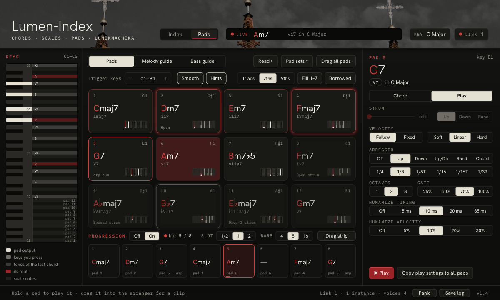
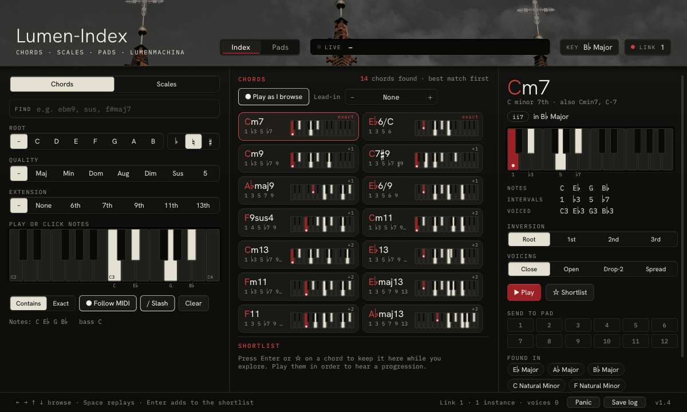
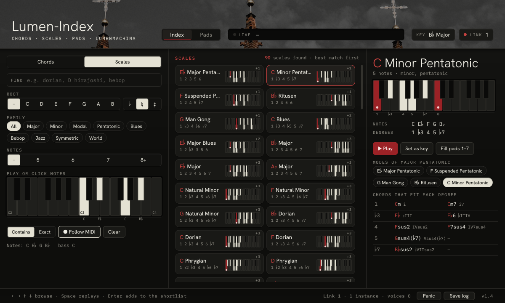
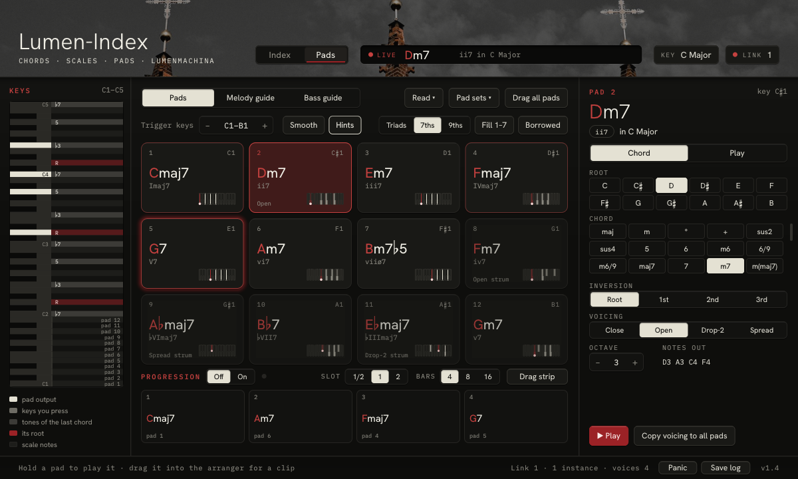
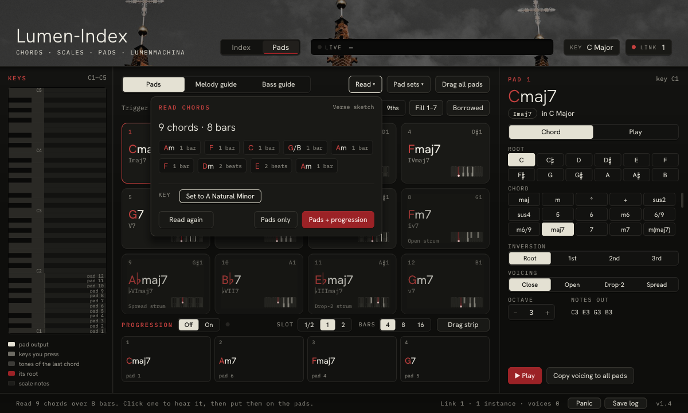
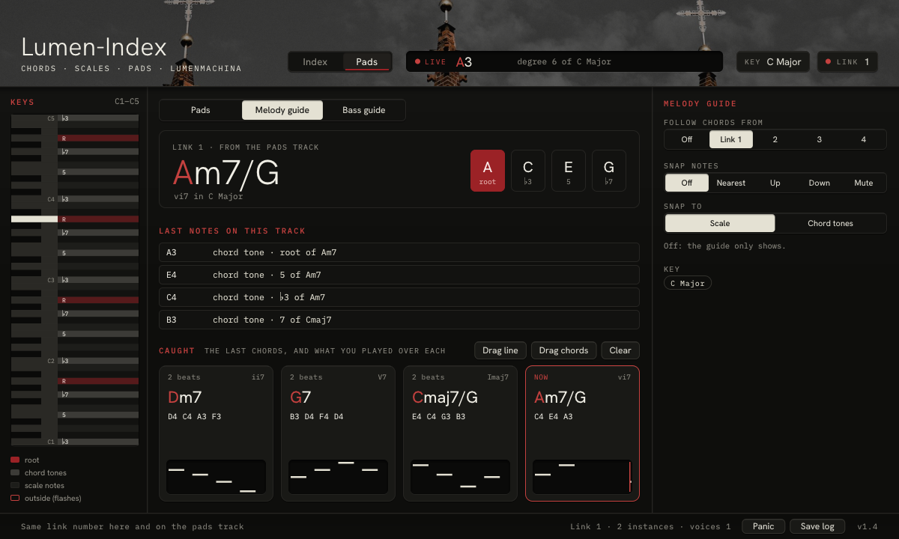

# Lumen-Index

**A chord and scale companion for making music.** Look up any of 492 chords and 56 scales by name, or play a few notes and see every chord and scale that holds them. Put the chords you like on 12 pads and play them from one octave of your keyboard, with strums, arpeggios, smooth voice leading and hints for what usually comes next. Let a progression play them in time with your song, read the chords out of a clip or MIDI file you already have, follow along on a melody or bass track and catch what you played, then drag any of it into your arrangement as MIDI.

Runs in **Bitwig Studio** (CLAP) and in **Logic Pro, GarageBand and MainStage** (Audio Unit MIDI FX), and as a **standalone app** for MIDI keyboards and hardware synths, on Windows and Mac. Current version: **1.4**.

## What's new in 1.4

- **Read chords from a clip.** Press **Read**, play a clip on the track, and Lumen-Index finds its chords and its key. Or drop a MIDI file on the window: an export from your DAW, or anything from a MIDI pack. One click puts the chords on the pads, and on the progression in time.
- **Clips you drag out fit your song.** They're timed at the song's tempo and carry no tempo marker, so Bitwig no longer asks to change your tempo when you drop one in. Strums and humanize in them used to be timed for 120 bpm whatever the song.
- **Bitwig on Windows:** the link between tracks, Caught and Read now keep running with every plugin window closed.
- **Save log** writes a much fuller report when something goes wrong, and there are fixes around Panic and drag-and-drop. Everything is in the [changelog](https://github.com/Lumen-Machina/Lumen-Index/blob/main/CHANGELOG.md).

## Find chords and scales

The **Index** page is a dictionary of 41 chord types and 56 scales on every root. Type a name into **FIND** (`ebm9`, `sus`, `f#maj7`, `dorian`, `d hirajoshi`, `bebop`), or play a few notes on your keyboard, or click them, and every chord or scale that holds them comes up, best match first. **Contains** shows everything that holds your notes; **Exact** only what matches them exactly. Filters for root, quality and extension (or, for scales, family and number of notes) narrow it down.

Browse by ear: the arrow keys step through the results and each chord plays as you reach it. Set a **Lead-in** pad and every candidate plays after it, so you hear each one coming from your chord, not on its own.

Every chord shows its notes, intervals and Roman numeral in your key (or what it borrows from outside it), with your choice of inversion and voicing, and the common scales it's found in. Send it to any pad in one click. Keep the good ones in a **shortlist** of up to 24, play it back in order, and drag it out as a progression.

Every scale shows its notes and degrees, its modes, and the chords on each degree; click a chord to hear it. **Set as key** makes the scale your key, and **Fill pads 1–7** puts its chords on the pads.

## Play chords on pads

Twelve pads sit on the twelve keys of one octave of your keyboard: C1 to B1 by default (Bitwig's note names, where middle C is C3), and you can move them anywhere from C-1 to C7. Every other key passes straight through to your instrument, so you can play pads with one hand and a melody with the other.

Any chord goes on any pad, each with its own root, chord type, inversion, voicing (**Close**, **Open**, **Drop-2**, **Spread**) and octave. Pick your key and scale in the header, and:

- **Fill 1–7** puts your key's chords on the first seven pads as triads, 7ths or 9ths.
- **Borrowed** puts chords from the parallel key on pads 8–12: in C major with 7ths, Fm7, A♭maj7, B♭7, E♭maj7 and Gm7, the colours behind a lot of bittersweet and shoegaze progressions. They're spelt properly (A♭, not G♯) and dimmed less than other out-of-key chords.
- **Smooth** makes each chord lead into the next with as little movement as possible, choosing the inversion and octave nearest the chord before, never more than a sixth from where you set the pad.
- **Hints** light up where to go next: after each pad, the usual next chords glow bright red, other common ones get a dim red edge, and one surprising-but-good option gets a pale glow.

Each pad also has its own way of playing:

- **Strum** up to 250 ms, up, down or random.
- **Velocity** that follows your playing (soft, linear or hard curve) or stays fixed.
- **Arpeggio**: up, down, up/down, random, or the whole chord retriggered; 1/4 to 1/32 with triplets; one to three octaves; gate from 25 to 100%. It follows the song's tempo and lands on its grid.
- **Humanize**: timing (up to 35 ms) and velocity (up to 30%), on chords, strums and arpeggios alike.

Copy a voicing or a set of play settings to every pad at once. Save all twelve pads, with every setting and the progression, as a named **pad set** and load it in any project. Loading a set, Fill 1–7, Borrowed and Read can each be undone.

## Play a progression

The progression strip under the pads plays them in order, in time with your song: up to 16 slots of half a bar, one bar or two bars, looping over 4, 8 or 16 bars. Click a slot, then click pads, and they fill the slots in order. Use the same pad twice to hold a chord; right-click a slot for a rest.

It runs while the transport runs, lined up with the bars of your song, so it follows loops and jumps and changes chords exactly on the beat. Arpeggios, strums and Smooth carry on in the strip. Press a pad yourself and it takes over until you let go.

## Read the chords of a clip

Got a chord part already? Open **Read** on the Pads page and either:

- **play it:** press Read, then play the clip on the same track; reading starts with its first note and stops when the song loops back or stops (up to 64 bars); or
- **drop a MIDI file** on the window, or open one. Drums (on channel 10) are left out.

Lumen-Index finds the chords bar by bar, one, two or four to a bar, whichever fits, and copes with block chords, arpeggios, slash chords, and a melody played over the chords. It finds the key too (major or natural minor). Click any chord to hear it, then put them on the pads in the order they come, at the inversion and octave they were played, with or without the progression in time, and change your key to match if you like. Pad sets has Undo for the pads and progression.

(Bitwig and Logic don't hand a clip dragged from their arranger to a plugin window, which is why Read listens to the clip as it plays, alongside the file drop.)

## Guide your melody and bass

Put Lumen-Index on a melody or bass track too, set it to **Melody guide** or **Bass guide**, and link it to your pads track with the same link number. The guide shows the chord being played and lights its tones (the bass guide points you to the root and the 5th), and checks each note you play: chord tone, scale note, or outside the key. Linked tracks share the key, so changing it on one changes it on all of them.

**Snap** can move stray notes up, down or to the nearest note in the scale or chord, or mute them.

**Caught** keeps the last four chords, each with the notes you played over it, how long it lasted and a little piano roll: chord tones bright, other notes in the key grey, notes outside it red. When the changes come fast you can see what just went by and what you played over it. Click a card to hear its chord. Drag a card out for the line you played over that chord, drag the whole line, or drag the chords at their real lengths.

## Get it into your song

Drag a pad, a chord, the shortlist, all twelve pads, the whole progression or a caught line onto your arranger, and it lands as a MIDI clip with the real notes, strums, arpeggios and humanize written in, timed at your song's tempo. The live display in the header names whatever is playing, with its numeral in your key.

## Work with hardware

The standalone app has the same window and engine as the plugin and talks to your MIDI gear directly, no DAW needed: choose a MIDI input, a MIDI output and a channel. It follows MIDI clock, so arpeggios lock to the tempo of your drum machine, sequencer or DAW, and after Start the progression and Read run on it too. Clock and Start/Stop pass on to your gear. On Mac it also has a virtual output, so Logic or any other app can record what it plays, and gear you replug while it runs comes back by itself.

## Where it runs

| | Windows | Mac (Intel and Apple Silicon) |
|---|---|---|
| **Bitwig Studio** (or any CLAP host) | CLAP | CLAP |
| **Logic Pro, GarageBand, MainStage** | | Audio Unit (MIDI FX slot) |
| **Standalone, for MIDI gear** | App | App |

In Bitwig it goes first on an instrument track, as a note effect; in Logic, in the MIDI FX slot above the instrument. Your pads, progression, key and settings are saved with the project, and every parameter can be automated.

## Getting it

**[Get Lumen-Index on Gumroad →](https://lumenmachina.gumroad.com/l/lumen-index)**

Pay what you want, including nothing. Windows and Mac downloads, with every future update free in your Gumroad library. The same downloads are on [GitHub releases](https://github.com/Lumen-Machina/Lumen-Index/releases/latest).

- [User guide](https://github.com/Lumen-Machina/Lumen-Index/blob/main/docs/GUIDE.md): how to use every part, step by step.
- [Manual](https://github.com/Lumen-Machina/Lumen-Index/blob/main/docs/MANUAL.txt): every control, in one plain-text file. It's also in each download, as `README.txt`.

Found a problem or have an idea? [Open an issue](https://github.com/Lumen-Machina/Lumen-Suite/issues/new/choose) and choose Lumen-Index. If something went wrong, press **Save log** in the plugin's footer right after and attach the file it puts on your Desktop.

---

[← All Lumen plugins](../README.md)
