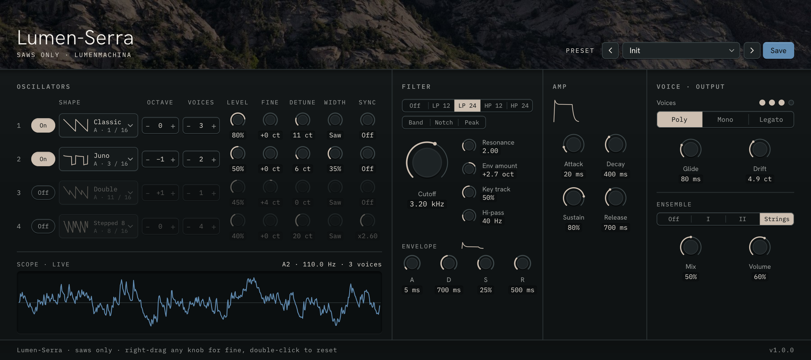
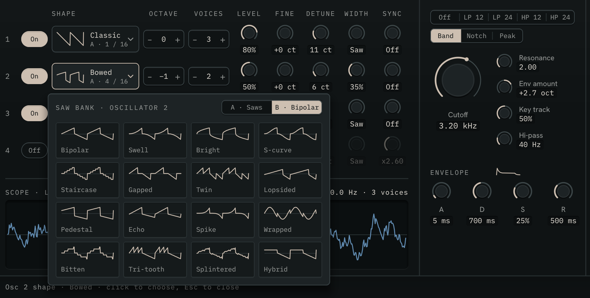
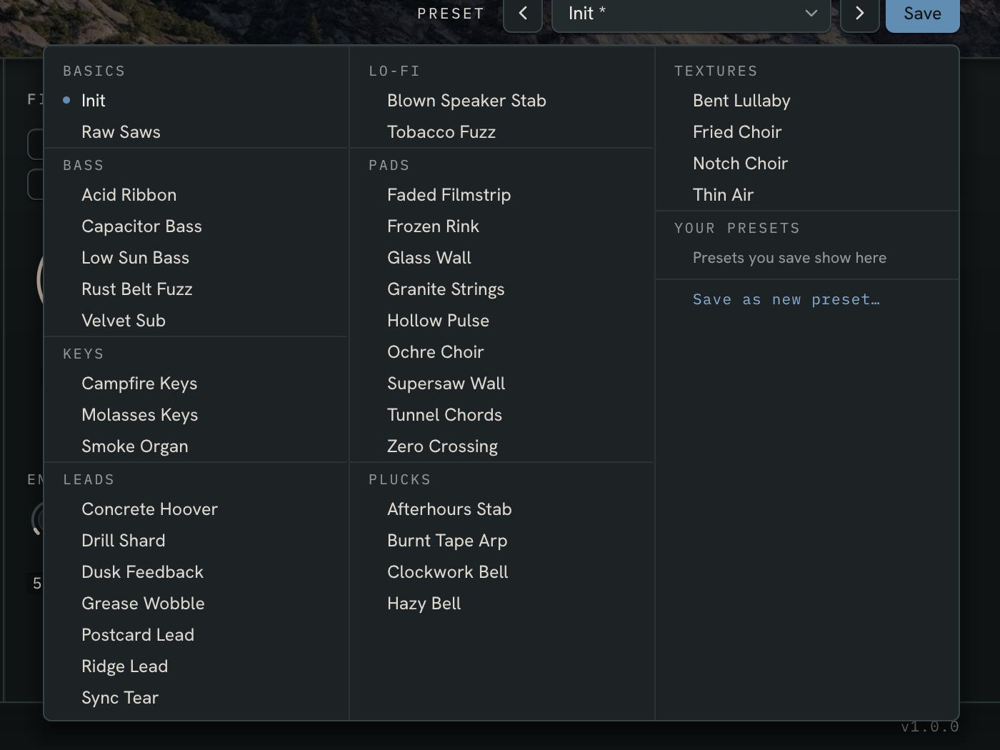

# Lumen-Serra 1.1 user guide

*This is the guide for Lumen-Serra version 1.1. Go back to the [Lumen-Serra page](lumen-serra.md).*

Lumen-Serra is a synth built only from saw waves, by [Lumen-Machina](https://lumen-machina.com). This guide covers every control in version 1.1, how to install it, and how to get the most out of it.

## Contents

1. [What Lumen-Serra is](#what-lumen-serra-is)
2. [Install](#install)
3. [A first 10 minutes](#a-first-10-minutes)
4. [The window](#the-window)
5. [Oscillators](#oscillators)
6. [The saw bank](#the-saw-bank)
7. [Filter](#filter)
8. [Envelopes](#envelopes)
9. [Voices, Glide and Drift](#voices-glide-and-drift)
10. [Ensemble and Volume](#ensemble-and-volume)
11. [The scope](#the-scope)
12. [Presets](#presets)
13. [In Bitwig and Logic](#in-bitwig-and-logic)
14. [Making sounds: recipes](#making-sounds-recipes)
15. [Troubleshooting](#troubleshooting)
16. [Reference](#reference)

---

## What Lumen-Serra is

Lumen-Serra is an instrument: put it on an instrument track and play it. Every sound it makes starts as a saw wave. There are no samples, no noise and no other waveforms, but there are 32 kinds of saw and a lot of ways to bend them:

- **32 saw shapes** in two banks: the saws in bank A, and in bank B the bipolar saws, which sound hollow and woody.
- **Four oscillators**, each stacking 1 to 4 saws per note, detuned and spread across the stereo field.
- **Width** pulls a saw toward a pulse wave. **Sync** hard-syncs it, up to eight times over.
- **Drift**: every saw wanders slowly in pitch, like an old analog synth or a worn tape.
- **Eight filter types**, a filter envelope and an amp envelope.
- **Poly** (8 notes), **Mono** and **Legato**, with Glide.
- An **ensemble**: two choruses and a string-machine ensemble.
- **36 factory presets**, and your own.

### Formats and where it runs

| | Windows | Mac (Intel and Apple Silicon, macOS 10.13 or later) |
|---|---|---|
| **Bitwig Studio** or any CLAP host | `Lumen-Serra.clap` | `Lumen-Serra.clap` |
| **Logic Pro, GarageBand, MainStage** | | `Lumen-Serra.component` (Audio Unit instrument) |

The sound and the window are the same in every format.

---

## Install

Download the Windows or Mac zip from [Gumroad](https://lumenmachina.gumroad.com/l/lumen-serra) (pay what you want).

| Download | What's inside |
|---|---|
| Windows zip | `Lumen-Serra.clap`, `README.txt` (the manual), `licences/` |
| Mac zip | `Lumen-Serra.clap`, `Lumen-Serra.component`, `README-mac.txt`, `README.txt` (the manual), `licences/` |

### Windows

1. Right-click the zip, choose **Properties**, tick **Unblock**, then **OK**. Extract the zip.
2. Copy `Lumen-Serra.clap` to `C:\Program Files\Common Files\CLAP\`.
3. Open Bitwig, or rescan plug-ins in **Settings > Locations > Plug-ins**.

The file isn't code-signed yet, so Windows may warn about an unknown publisher the first time.

### Mac

1. Copy the files you want:
   - **CLAP** (Bitwig): `Lumen-Serra.clap` to `~/Library/Audio/Plug-Ins/CLAP/`
   - **Audio Unit** (Logic, GarageBand, MainStage): `Lumen-Serra.component` to `~/Library/Audio/Plug-Ins/Components/`

   In Finder, use **Go > Go to Folder…** and paste the path. Make the folder if it's missing.
2. The builds aren't signed with an Apple developer account yet, so macOS blocks them at first. Open Terminal and run, once, the line for each file you installed:

   ```
   xattr -dr com.apple.quarantine ~/Library/Audio/Plug-Ins/Components/Lumen-Serra.component
   xattr -dr com.apple.quarantine ~/Library/Audio/Plug-Ins/CLAP/Lumen-Serra.clap
   ```
3. Restart Logic or Bitwig.

### Loading it in Bitwig

Add **Lumen-Serra** (by Lumen-Machina) to an instrument track from the device browser, then click the device's window button to open its window. The 36 factory presets also show in Bitwig's preset browser.

### Loading it in Logic Pro (also GarageBand, MainStage)

Make a **Software Instrument** track, click the instrument slot and choose **AU Instruments > Lumen-Machina > Lumen-Serra**. If it doesn't appear, check the Terminal step above, then open **Logic Pro > Settings > Plug-in Manager** and **Reset & Rescan Selection**.

---

## A first 10 minutes

1. **Play.** Load Lumen-Serra on an instrument track and hold a chord. You're hearing **Init**: two stacks of detuned saws through a low-pass filter and the string ensemble. The scope at the bottom left shows the wave, and the dots by **Voices** light for each note.
2. **Change the saw.** Click the shape box on row 1 (it says **Classic**). The saw bank opens with 16 shapes drawn. Click **Juno**, then try a few more while holding a note. Click the **B · Bipolar** tab and pick **Bipolar**: the sound turns hollow.
3. **Thicken it.** On row 1, click **+** under **Voices** until it says 4, then drag **Detune** up. The note spreads across the speakers.
4. **Shape it with Width.** Drag row 1's **Width** knob up slowly. The saw thins into a pulse wave, hollow and reedy.
5. **Tear it with Sync.** Drag **Sync** on row 1 up and down while you hold a note. That's the classic hard-sync sweep.
6. **Open and close the filter.** Drag the big **Cutoff** knob. Then drag **Env amount** up, set the filter envelope's **D** (decay) short and play staccato notes: each note now has a pluck.
7. **Fine adjustment.** Drag any knob with the **right** mouse button: it moves ten times slower. Double-click a knob to reset it.
8. **Type a value.** Click the number under Cutoff, type `800` and press Enter.
9. **Try the voice modes.** Click **Mono**, raise **Glide**, and play a melody: each note slides from the last. **Legato** slides only when notes overlap.
10. **Presets.** Click the preset name at the top right. All 36 presets are listed by category. Click one, or use the **‹ ›** arrows to step through them. When you've made something you like, click **Save**.

---

## The window



From top to bottom: the header with the preset bar, then four sections side by side (**Oscillators** with the scope, **Filter**, **Amp**, **Voice · Output**), then the footer.

### Header and preset bar

| Control | What it does |
|---|---|
| **‹** and **›** | Load the previous or next preset in the list. |
| Preset name | Click for the preset menu. A **\*** after the name means the sound has changed since it was loaded or saved. |
| **Save** | On one of your presets, saves over it. On a factory preset (or Init), asks for a name. A moment of **Saved** confirms it. |

### Footer

The footer explains the control under the pointer: its name, its range, its default, and how to use it. For example: `Cutoff · 40 Hz…16.00 kHz · default 3.20 kHz · right-drag for fine, double-click to reset, click the value to type`. While you drag, it shows the live value. The version number is on the right.

### Mouse and keyboard in general

| Action | Result |
|---|---|
| Drag a knob up or down | Changes it. 200 pixels covers the whole range. |
| Drag with the **right** mouse button | Ten times finer. Works on knobs and on the Octave and Voices numbers. |
| Hold **Ctrl** (Mac: **Cmd** or **Option**) while dragging or scrolling | Also ten times finer. |
| Scroll over a knob | Nudges it (2% a notch; Ctrl for finer). |
| Double-click a knob | Resets it to its default, the value it has in Init. Two clicks within 400 ms count, in hosts that don't pass double-clicks on. |
| Click the value under a knob | Type a new one. **Enter** sets it, **Esc** leaves it as it was. |
| Click **−** or **+** | Steps Octave or Voices. You can also drag the number. |

**Shift does nothing**, on purpose: Bitwig doesn't pass the Shift key to plugin windows, so nothing in Lumen-Serra needs it. A right-click never opens a menu.

When you type a value, units are optional and short forms work: `880` or `2.5k` for Hz, `250 ms` or `1.5` (seconds) for times, `40` or `40%` for percentages, `2.5` or `x2.5` for Sync, `-3` for octaves of filter envelope, and names for choices (`Juno`, `lp 24`, `legato`).

While a menu or a typed value is open, the window has your keyboard. Once it closes, the keyboard goes back to Bitwig or Logic, so play and the computer keyboard as notes keep working.

---

## Oscillators

Four oscillators, one per row. Each makes a stack of saws on every note you play.

| Control | Range | What it does |
|---|---|---|
| **On** | On, Off | Switches the oscillator on. An oscillator that's off dims; its settings stay. |
| **Shape** | 32 saws | Which saw. Click it for the [saw bank](#the-saw-bank), or scroll on it to step through all 32. Its little trace shows the shape with Width and Sync applied. |
| **Octave** | −2 to +2 | Octaves up or down. |
| **Voices** | 1 to 4 | How many saws stack on each note. Changes take effect on the next note. |
| **Level** | 0–100% | The oscillator's volume. |
| **Fine** | −50 to +50 cents | Tunes it slightly. Two oscillators a few cents apart beat slowly against each other. |
| **Detune** | 0–50 cents | How far the stacked saws spread apart, up to 50 cents either way. With 2 or more Voices, the saws also spread from left to right. |
| **Width** | Saw to 100% | Pulls the saw toward a pulse wave, by taking away a shifted copy of itself. Around 50% it's a square-like, hollow tone. At **Saw** it's untouched. |
| **Sync** | Off to ×8 | Hard sync: the saw restarts at the note's pitch but runs up to eight times faster in between. Sweep it for the tearing, vocal sync sound. |

Every control except Voices changes while notes ring. Shape, Width and Sync crossfade into their new wave, so sweeping them never clicks.

Init uses oscillators 1 and 2. Turn on 3 and 4 for more: an octave up for brightness, or a sub an octave down.

---

## The saw bank



Click an oscillator's shape box to open it. The bank opens on the bank the oscillator is using, with the current shape outlined.

- Click a shape to choose it, or a tab (**A · Saws**, **B · Bipolar**) to switch banks.
- With the keys: the arrows move around (Left and Right walk across both banks as one grid of 8 × 4), **Enter** chooses, **Esc** closes.
- Hovering a shape shows its name in the footer.
- The shape box shows the bank and number, for example `B · 6 / 16`.

### Bank A: the saws

A saw rises or falls in a straight ramp, then jumps back. These sixteen bend that ramp in different ways.

| Shape | What it is | How it sounds |
|---|---|---|
| **Classic** | The plain falling ramp. | Bright and full: every harmonic. |
| **Ramp up** | The same ramp, rising. | The same tone; lines up differently against the other oscillators and with Sync. |
| **Juno** | A ramp with a slight curve. | A touch softer, like the Roland chip saws. |
| **Bowed** | A more curved ramp. | Rounder and darker. |
| **Capacitor** | The curve of a capacitor discharging, as in old analog oscillators. | Punchy, with a weighty low end. |
| **Soft** | A saw gently saturated. | Warm, with the edges rounded off. |
| **Rounded** | Only the first four harmonics of a saw. | Very soft, close to a sine with a little buzz. |
| **Stepped 8** | The ramp in 8 steps. | A little grainy, like an early digital synth. |
| **Stepped 4** | The ramp in 4 steps. | Chunky and hollow. |
| **Crushed** | The ramp at low resolution in time and level. | Bit-crushed, lo-fi. |
| **Double** | A saw with an octave-up saw mixed in. | Bright and octave-heavy. |
| **Triple** | A saw with a saw an octave and a fifth up. | Organ-like, metallic. |
| **Notched** | A saw with a step in the middle. | Nasal, some harmonics missing. |
| **Bent** | A ramp with a kink: steep, then slow. | Edgy, a little brass. |
| **Folded** | A saw folded back on itself. | Buzzy and vocal. |
| **Broken** | A saw with a fixed roughness along its ramp. | Gritty, rough. |

### Bank B: the bipolar saws

In a bipolar saw, each tooth starts at zero, ramps away and snaps back to zero: one tooth above zero, then one below. A plain saw jumps from the bottom straight to the top instead. The basic **Bipolar** shape mirrors itself every half cycle, so it has only odd harmonics. It sounds hollow and woody, closer to a square wave than a saw. The other fifteen bend those teeth.

| Shape | What it is | How it sounds |
|---|---|---|
| **Bipolar** | Straight teeth, up then down. | Hollow, woody, odd harmonics only. |
| **Swell** | Teeth that curve upward slowly. | Softer, flute-like. |
| **Bright** | Teeth that rise fast, then level off. | Brighter, more edge. |
| **S-curve** | Teeth with smooth S-shaped ramps. | Round and gentle. |
| **Staircase** | Teeth in 5 steps. | Stepped, like an old sound chip. |
| **Gapped** | Teeth with a rest at zero after each. | Thin and reedy. |
| **Twin** | Two small teeth in each half. | Brighter, with a strong octave. |
| **Lopsided** | A long tooth above zero, a short one below. | Even harmonics come back: fuller, saw-like. |
| **Pedestal** | Teeth that start from a step. | Strong and square-like. |
| **Echo** | A full tooth above, a half-height tooth below. | A blend of saw and hollow. |
| **Spike** | Teeth that stay low, then shoot up. | Thin, bright, buzzy. |
| **Wrapped** | Teeth that wrap back through zero. | Vocal, a little like a folded wave. |
| **Bitten** | Teeth at low resolution. | Crunchy, lo-fi. |
| **Tri-tooth** | Three small teeth above, one big tooth below. | Metallic and odd. |
| **Splintered** | Teeth with a fixed roughness. | Gritty and hollow. |
| **Hybrid** | Half a plain saw, half a bipolar one. | Between the two banks. |

Width, Sync, Detune and the filter all work on bank B as on bank A.

---

## Filter

The filter shapes the stacked saws of every note. Each note has its own filter, following its own envelope.

| Control | Range | What it does |
|---|---|---|
| **Filter type** | Off, LP 12, LP 24, HP 12, HP 24, Band, Notch, Peak | See the table below. |
| **Cutoff** | 40 Hz to 16 kHz | Where the filter acts. |
| **Resonance** | 0.50 to 18.00 | Emphasis at the cutoff. Around 0.7 it's smooth; high values ring and whistle. |
| **Key track** | 0–100% | How much higher notes open the filter. At 100%, the cutoff follows the keyboard exactly, an octave per octave, from middle C (C3). At 0%, every note shares one cutoff. |
| **Hi-pass** | 20 Hz to 1.2 kHz | A gentle low cut (12 dB per octave) ahead of the filter, to keep big stacks from getting muddy. |
| **Env amount** | −6 to +6 octaves | How far the filter envelope moves the cutoff. Below zero, the envelope closes the filter instead of opening it. |

| Filter type | What it does |
|---|---|
| **Off** | The oscillators raw. The filter, the hi-pass and the filter envelope are all bypassed. |
| **LP 12** | Low-pass, 12 dB per octave: gentle, keeps some air. |
| **LP 24** | Low-pass, 24 dB per octave: the classic, darker synth filter. |
| **HP 12**, **HP 24** | High-pass, 12 or 24 dB per octave: takes away the lows. |
| **Band** | Band-pass: keeps a band around the cutoff. Thin, telephone-like. |
| **Notch** | Cuts a narrow band at the cutoff. Sweep it for a phaser-like sound. |
| **Peak** | A +12 dB bell at the cutoff: everything else stays, the cutoff stands out. |

The filter type is chosen from the two rows of buttons at the top of the Filter section.

---

## Envelopes

Two ADSR envelopes. The little trace above each set redraws as you turn its knobs. The filter's trace flattens when Env amount is 0, since the envelope then does nothing.

| | Attack | Decay | Sustain | Release |
|---|---|---|---|---|
| **Filter** (the **A D S R** under Envelope) | 2 ms to 4 s | 10 ms to 4 s | 0–100% | 10 ms to 6 s |
| **Amp** (the Amp section) | 2 ms to 4 s | 10 ms to 4 s | 0–100% | 10 ms to 6 s |

- **Attack**: how long the envelope takes to rise when you press a key.
- **Decay**: how long it takes to fall to the sustain level.
- **Sustain**: the level it holds while the key is down.
- **Release**: how long it takes to fade after you let go. Releases fade out smoothly, the way a capacitor discharges: a note is about 35 dB down after its release time, and silent a little after twice its release time.

---

## Voices, Glide and Drift

| Control | What it does |
|---|---|
| **Voice mode: Poly** | Up to **8 notes** at once. A ninth note quickly fades out the oldest. Released notes keep ringing while you play the next chord. |
| **Voice mode: Mono** | One note at a time. Each new note restarts both envelopes. Hold a note, play another, let go of the second: it returns to the first. |
| **Voice mode: Legato** | One note at a time. Overlapping notes slide without restarting the envelopes; a note played after letting go starts fresh. |
| **Glide** | Off to 2 seconds. How long a note takes to slide to the next. In Mono, every note glides from the last; in Legato, only overlapping notes. Poly doesn't glide. |
| **Drift** | 0 to 14 cents. Every saw wanders slowly and independently in pitch. A little warms a sound; a lot makes it seasick, like a worn tape. |

The **Voices** dots light for the notes sounding: all eight in Poly, one in Mono and Legato.

Changing the voice mode while notes are held releases them, so nothing hangs.

---

## Ensemble and Volume

| Control | What it does |
|---|---|
| **Ensemble** | **Off**, **I** (a slow chorus), **II** (a deeper chorus) or **Strings** (the string-machine ensemble: three delays swaying at once, for wide, shimmering pads). |
| **Mix** | How much of the ensemble you hear, 0–100%. |
| **Volume** | The output level, 0–100%. |

After Volume, a limiter keeps the output under −1 dBFS, however many saws you stack. Turn Volume down if you hear the limiter squashing a big chord.

---

## The scope

The scope under the oscillators shows the sound.

- **While notes play**, it shows Lumen-Serra's output, held still on the lowest note. Above it, the readout gives that note, its frequency and how many voices are sounding: `A1 · 110.0 Hz · 3 voices`. Note names follow Bitwig and Logic, where middle C is C3.
- **When nothing plays**, it previews two cycles of the oscillators that are on, mixed at their levels and octaves (`SCOPE · PREVIEW`).

While the saw bank is open over it, the scope holds still until the bank closes.

---

## Presets



### The preset menu

Click the preset name to open it. Factory presets are listed by category, in columns, then **YOUR PRESETS**. The current preset has a blue dot. Click one to load it; **Save as new preset…** at the bottom asks for a name.

With the keys: Up and Down move through the list, Left and Right move between columns, Enter loads, Esc closes.

### The 36 factory presets

| Category | Preset | Sound |
|---|---|---|
| Basics | **Init** | Lumen-Serra's starting point: two detuned saws, a 24 dB low-pass and the string ensemble. |
| | **Raw Saws** | Four detuned Classic saws with the filter off: the oscillators as they are. |
| Bass | **Acid Ribbon** | A 303-like line, one Classic saw into a screaming 24 dB filter, sliding when notes overlap. |
| | **Capacitor Bass** | Mono bass: the Capacitor saw over a Stepped 4 sub, a short filter pluck, a touch of glide. |
| | **Low Sun Bass** | A round, soft mono bass with a lazy glide, more felt than heard. |
| | **Rust Belt Fuzz** | A crushed mono bass over a stepped sub, a chewy resonant pluck, a little drift. |
| | **Velvet Sub** | A deep, clean sub an octave under the note, with a hint of Capacitor on it, steady enough for a club. |
| Keys | **Campfire Keys** | Hollow S-curve teeth with an octave of Soft saw on top, a gentle pluck that rings on. |
| | **Molasses Keys** | Crunchy chords squeezed between a low and a high cut, wobbly and boxy, like a cheap keyboard through a cheaper amp. |
| | **Smoke Organ** | A thin, hollow organ from Pedestal, Hybrid and Lopsided teeth, cut at both ends, for held soul chords. |
| Leads | **Concrete Hoover** | A huge detuned rave lead, slightly synced, that slides between notes. |
| | **Drill Shard** | A hard-synced Splintered saw with a Spike on top, high-passed and snapping, for chopped lines. |
| | **Dusk Feedback** | Bright teeth over a Broken saw, a ringing peak and slow slides, like a guitar left feeding back. |
| | **Grease Wobble** | A Broken saw that won't sit still, heavy drift, a chewy resonant filter, slow legato slides. |
| | **Postcard Lead** | A soft, slightly flat mono lead that slides into every note. |
| | **Ridge Lead** | Legato lead with glide: one saw synced against another, the filter envelope biting on each new phrase. |
| | **Sync Tear** | Mono lead: a hard-synced Ramp up over a sub saw. Automate Osc 1 Sync for the tearing sweep. |
| Lo-fi | **Blown Speaker Stab** | A crushed, peaky stab that sounds pushed through a broken speaker. |
| | **Tobacco Fuzz** | Crushed and stepped saws, lots of drift, a resonant Peak filter: broken-toy fuzz. |
| Pads | **Faded Filmstrip** | Warm detuned Juno saws, slow and dark, with the pitch wow of an old tape. |
| | **Frozen Rink** | An icy, slow ambient pad with a faint high overtone. |
| | **Glass Wall** | Three stacks of detuned saws, Splintered and Twin in the mix: a wall of strings that hides the chords. |
| | **Granite Strings** | A slow string-machine pad: Juno and Classic stacks through the Strings ensemble. |
| | **Hollow Pulse** | Saws pulled into pulse waves with Width: a hollow, Juno-style pad. |
| | **Ochre Choir** | Swell teeth and Bowed saws squeezed into the mids, a distant choir that takes its time. |
| | **Supersaw Wall** | All four oscillators, sixteen saws a note: a shoegaze wall. Hi-pass keeps the low end clear. |
| | **Tunnel Chords** | Closed-down chords that open slowly over a few seconds, like a filter sweep in the mix. |
| | **Zero Crossing** | Four detuned Bipolar saws over an S-curve an octave down, a slow swell and the string ensemble. Hollow. |
| Plucks | **Afterhours Stab** | A tight house chord stab, dark and snappy, cut low so a sample can sit on top. |
| | **Burnt Tape Arp** | Staircase teeth in a short resonant blip, for arpeggios that sound recorded off a TV. |
| | **Clockwork Bell** | A synced Tri-tooth through a peak filter, a small metallic bell for fast melodies. |
| | **Hazy Bell** | Wrapped teeth with a synced Bipolar overtone, a bell heard through a wall. |
| Textures | **Bent Lullaby** | Bent saws at full drift with an Echo tooth an octave up, a music box left in the sun. |
| | **Fried Choir** | Twin teeth and a Notched saw through a notch filter that closes as it swells, like a vocoder with a cold. |
| | **Notch Choir** | A notch drifting up through Juno and Triple stacks: a slow, phaser-like choir. |
| | **Thin Air** | Folded saws through a slow band-pass sweep, wide and airy. |

### Saving your own

- **Save** on a factory preset (or Init) asks for a name. Each word starts with a capital as you type, since Bitwig doesn't pass Shift. Names can use letters, numbers, spaces and `- _ . ( ) ' # & + ,`, up to 40 characters.
- **Save** on one of your own presets saves over it straight away.
- **Save as new preset…** in the menu always asks for a name.
- Saving with the name of one of your presets replaces it; the dialog says so before you confirm.

Your presets are `.lumenpreset` files, in:

| | Folder |
|---|---|
| Windows | `%APPDATA%\Lumen-Serra\Presets` |
| Mac | `~/Library/Application Support/Lumen-Serra/Presets` |

To rename or delete one, rename or delete its file there. To share one, send the file; whoever gets it drops it into the same folder. The menu reads the folder each time it opens.

Your presets also show in Bitwig's preset browser, and Bitwig's own **Save preset** works too.

### What's saved with your project

Everything: every control, the preset's name and whether it had changed (the **\***). A project made with any earlier version of Lumen-Serra opens with the same sound.

---

## In Bitwig and Logic

### Bitwig: remote controls

Lumen-Serra comes with remote-control pages for your controller, and for Bitwig's own **Remote Controls** panel:

| Page | Controls |
|---|---|
| **Osc 1** to **Osc 4** | Shape, Level, Octave, Voices, Detune, Width, Sync, On |
| **Filter** | Filter type, Cutoff, Resonance, Key track, Hi-pass, Env amount |
| **Envelopes** | Filter A, D, S, R; Amp A, D, S, R |
| **Voice and Output** | Ensemble, Ensemble mix, Voice mode, Glide, Drift, Volume |

### Bitwig: automation and modulators

Every control can be automated. Bitwig's modulators (LFOs, envelopes, the Expressions device and the rest) can move every knob, and the window shows the knob where you left it while the sound moves. Try an LFO on Osc 1 **Sync** or **Width**, or a slow random modulator on **Cutoff**.

### Logic

Every control shows in Logic's automation lanes and its generic Controls view, under the same names. Choose **Editor** in the plug-in window for Lumen-Serra's own window.

### MIDI

Lumen-Serra plays the notes you send it. It doesn't respond to velocity, pitch bend, the mod wheel or the sustain pedal (see [Known limitations](#known-limitations)). **All Notes Off** (CC 123) releases every note, and **All Sound Off** (CC 120) silences them at once.

---

## Making sounds: recipes

Start each from **Init** unless it says otherwise.

**A supersaw.** Oscillators 1 and 2 on **Classic**, both at 4 **Voices**, **Detune** 20–30 cents, Osc 2 an octave down. Filter **LP 12** around 6 kHz, **Ensemble II** at 40%. For a wall, turn on Osc 3 an octave up at 4 Voices.

**A hollow pulse pad.** Osc 1 on **Juno**, **Width** 45%, 3 Voices. Slow Amp **Attack** (800 ms) and **Release** (2 s). **Strings** ensemble at 60%. Add **Drift** around 6 cents for movement.

**A sync lead.** **Mono**, **Glide** 60 ms. Osc 1 on **Ramp up**, 1 Voice, **Sync** around ×3. Osc 2 on **Classic**, an octave down, Level 40%. Filter **LP 24**, Resonance 2. Automate or modulate Osc 1 **Sync**.

**An acid line.** Load **Acid Ribbon**. Play overlapping notes to slide, separate notes to restart. Turn **Cutoff** and **Env amount** live, or put a Bitwig LFO on Cutoff.

**A warped tape pad.** Osc 1 and 2 on **Juno** and **Bowed**, 3 Voices each. **Drift** 10–14 cents. Filter **LP 24** low, around 1.5 kHz. Slow Attack and Release. Ensemble **I**.

**A house chord stab.** Filter **LP 24**, Cutoff around 600 Hz, Resonance 3, **Env amount** +3 oct, filter **D** 180 ms, **S** 0%. Amp **D** 300 ms, **S** 0%, **R** 150 ms. Play chords on the off-beats.

**A hollow, woody key.** Osc 1 on **Bipolar** (bank B), Osc 2 on **S-curve**, an octave up at 30%. Filter **LP 12**, Env amount +2 oct, short filter decay. Amp Sustain 0%, Decay 900 ms.

**A bell.** Osc 1 on **Tri-tooth**, **Sync** ×2.6. Filter **Peak** at 2 kHz, Resonance 6. Amp Attack 2 ms, Decay 1.2 s, Sustain 0%.

---

## Troubleshooting

### Lumen-Serra doesn't appear in Bitwig

Check the file is in `C:\Program Files\Common Files\CLAP\` (Mac: `~/Library/Audio/Plug-Ins/CLAP/`), then rescan in **Settings > Locations > Plug-ins**. On Windows, if you didn't unblock the zip before extracting, delete the file, unblock the zip, and extract it again.

### Lumen-Serra doesn't appear in Logic, or macOS says it's damaged

Run the `xattr` line from the [Mac install](#mac) for the `.component`, then **Logic Pro > Settings > Plug-in Manager > Reset & Rescan Selection**.

### No sound

- Is the track getting notes? The **Voices** dots light when it is.
- Is at least one oscillator **On**, with **Level** up?
- Is **Volume** up? Is the filter closed (Cutoff very low with LP 24, or very high with HP 24)?
- With a long Attack, a short note may end before it's heard.

### A sound is too loud, or squashed

Big chords of stacked saws add up. The limiter stops clipping, but you'll hear it pump. Turn **Volume** down, use fewer **Voices**, or lower the oscillators' **Levels**.

### Notes cut off when I play big chords

Poly plays 8 notes; a ninth fades out the oldest. Long releases count while they ring, but only held notes count toward the 8.

### A note keeps sounding

Long Release times ring on after you let go (up to 6 s, and longer at a low level). If a note truly hangs, send **All Notes Off**, or switch Voice mode and back.

### Fine adjustment doesn't work with Shift

On purpose: Bitwig doesn't pass Shift to plugins. Drag with the right mouse button, or hold Ctrl (Mac: Cmd or Option).

### High CPU

Each note can be up to 16 saws (4 oscillators × 4 Voices), and Poly plays 8 notes plus their releases. Turn off oscillators you don't need, use fewer Voices, or shorten long releases. A full 8-note chord of 16 saws a note uses a few percent of one core at 48 kHz.

### Something else

[Open an issue](https://github.com/Lumen-Machina/Lumen-Suite/issues/new/choose) and choose Lumen-Serra, or email hello@lumen-machina.com. Say what you did, what you expected and what happened, with your system and host.

---

## Reference

### Keyboard and mouse shortcuts

| Where | Input | Result |
|---|---|---|
| Knobs | Drag | Change (200 px = full range) |
| | Right-drag, or Ctrl/Cmd/Option-drag | Fine (10×) |
| | Scroll | Nudge 2% (Ctrl: finer) |
| | Double-click | Reset to default |
| | Click the value | Type a value; Enter sets, Esc leaves |
| Octave, Voices | Click − or + | Step |
| | Drag the number (right-drag for fine) | Step by dragging |
| | Scroll | Step |
| Shape box | Click | Open the saw bank |
| | Scroll | Step through all 32 shapes |
| Saw bank | Arrows | Move (Left and Right cross between banks) |
| | Enter / Esc | Choose / close |
| Preset menu | Up, Down, Left, Right | Move (Left and Right between columns) |
| | Enter / Esc | Load / close |
| Save dialog, typed values | Enter / Esc / Backspace | Save or set / cancel / delete |

### Parameters the host can automate

| Parameter | Range | Default (Init) |
|---|---|---|
| Osc 1–4 On | Off, On | On, On, Off, Off |
| Osc 1–4 Shape | Classic … Hybrid (32) | Classic, Juno, Double, Stepped 8 |
| Osc 1–4 Level | 0–100% | 80%, 50%, 45%, 40% |
| Osc 1–4 Octave | −2 to +2 | 0, −1, +1, 0 |
| Osc 1–4 Fine | −50 to +50 cents | 0, 0, +4, 0 |
| Osc 1–4 Voices | 1 to 4 | 3, 2, 1, 4 |
| Osc 1–4 Detune | 0 to 50 cents | 11, 6, 0, 20 |
| Osc 1–4 Width | Saw to 100% | Saw, 35%, Saw, Saw |
| Osc 1–4 Sync | Off to ×8 | Off, Off, Off, ×2.60 |
| Drift | 0 to 14 cents | 4.9 cents |
| Filter Type | Off, LP 12, LP 24, HP 12, HP 24, Band, Notch, Peak | LP 24 |
| Cutoff | 40 Hz to 16 kHz | 3.20 kHz |
| Resonance | 0.50 to 18.00 | 2.00 |
| Key Track | 0–100% | 50% |
| Hi-pass | 20 Hz to 1.2 kHz | 40 Hz |
| Filter Env Amount | −6 to +6 oct | +2.7 oct |
| Filter Attack | 2 ms to 4 s | 5 ms |
| Filter Decay | 10 ms to 4 s | 700 ms |
| Filter Sustain | 0–100% | 25% |
| Filter Release | 10 ms to 6 s | 500 ms |
| Attack | 2 ms to 4 s | 20 ms |
| Decay | 10 ms to 4 s | 400 ms |
| Sustain | 0–100% | 80% |
| Release | 10 ms to 6 s | 700 ms |
| Ensemble | Off, I, II, Strings | Strings |
| Ensemble Mix | 0–100% | 50% |
| Voice Mode | Poly, Mono, Legato | Poly |
| Glide | Off to 2 s | 80 ms |
| Volume | 0–100% | 60% |

### Limits and numbers

| | |
|---|---|
| Oscillators | 4, each 1 to 4 saws |
| Saws per note | Up to 16 |
| Poly | 8 held notes; up to 32 sounding with releases |
| Saw shapes | 32 (two banks of 16), band-limited wavetables |
| Sample rates | Any; tested from 22.05 kHz to 192 kHz |
| Output | Stereo, limited to −1 dBFS |
| Window | 1350 × 600, scaled by your display settings |
| Factory presets | 36, in 8 categories |
| Preset names | Up to 40 characters |

### Where files go

| | Windows | Mac |
|---|---|---|
| CLAP plugin | `C:\Program Files\Common Files\CLAP\Lumen-Serra.clap` | `~/Library/Audio/Plug-Ins/CLAP/Lumen-Serra.clap` |
| Audio Unit | | `~/Library/Audio/Plug-Ins/Components/Lumen-Serra.component` |
| Your presets | `%APPDATA%\Lumen-Serra\Presets` | `~/Library/Application Support/Lumen-Serra/Presets` |

### Known limitations

- No response to velocity, pitch bend, the mod wheel or the sustain pedal yet.
- No LFO of its own: use your host's modulators (in Bitwig, its LFO and envelope modulators work on every knob).
- The window has one size; it scales with your display settings but can't be dragged larger.
- Presets can't be renamed or deleted from inside the window; do it in the presets folder.
- The files aren't code-signed (Windows) or notarized (Mac) yet; see [Install](#install).

---

[← Lumen-Serra page](lumen-serra.md) · [All Lumen plugins](../README.md)
