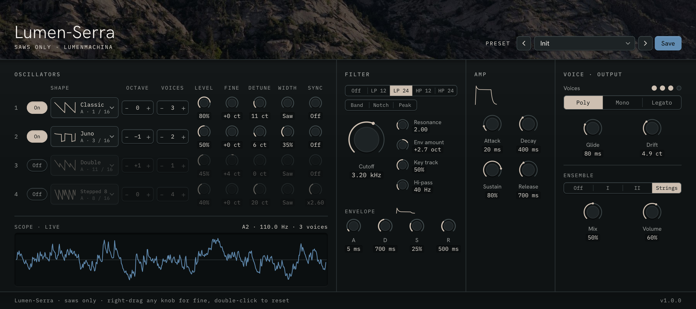
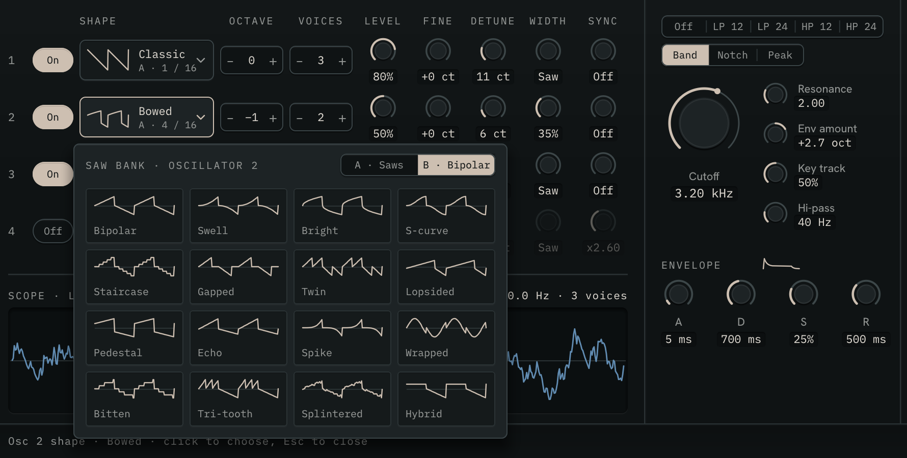
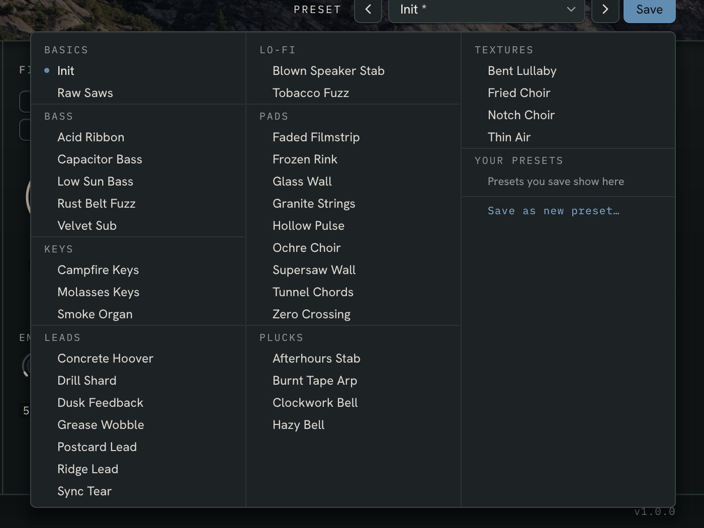

# Lumen-Serra

**A synth built only from saw waves.** Thirty-two saw shapes in two banks, four oscillators of up to four detuned saws each, saw-made pulse width and hard sync, eight filter types with their own envelope, Poly, Mono and Legato, and a string-machine ensemble. For drifting pads, fuzzy basses, house stabs, acid lines and walls of sound.

Runs in **Bitwig Studio** (and any CLAP host) on Windows and Mac, and in **Logic Pro** as an Audio Unit. Current version: **1.1** · [User guide](lumen-serra-guide.md)

## Thirty-two saws

Bank A has the saws: the Classic ramp and fifteen others, from the soft Juno and the curved Capacitor to the stair-stepped Stepped 8 and 4, the bit-crushed Crushed, the doubled and tripled teeth of Double and Triple, and the cracked Broken.

Bank B has the **bipolar saws**: each tooth starts at zero and snaps back to it, one above zero and one below, where a plain saw jumps from the bottom straight to the top. They sound hollow and woody, closer to a square wave than a saw, and sixteen variations bend them in different directions: curved, stepped, gapped, lopsided, folded, splintered.

Click an oscillator's shape to see every saw in the bank drawn out, and pick one.

## Four oscillators

Each oscillator is a stack of one to four saws, spread across the stereo field by **Detune**, with its own Level, Octave and Fine. **Width** pulls a saw toward a pulse wave, made from saws alone. **Sync** hard-syncs it up to eight times over, for the tearing, vocal sweep. **Drift** lets every saw wander slowly in pitch, like an old analog synth or a worn tape.

Every wavetable is band-limited, and shapes crossfade as they change, so sweeping Width or Sync never clicks.

## Filter, envelopes and voices

- **Filter:** Off, low-pass 12 and 24 dB, high-pass 12 and 24 dB, Band, Notch and Peak, with Resonance, Key track and a Hi-pass ahead of it to keep big stacks clean.
- **Filter envelope:** a full ADSR of up to six octaves either way.
- **Amp envelope:** ADSR.
- **Voices:** Poly (eight notes), Mono, or Legato, with Glide.
- **Ensemble:** two choruses and a string-machine ensemble.
- A limiter keeps the output from clipping, however many saws you stack.

## See what you play

A live oscilloscope shows the sound, held still on the note you play, or a preview of the oscillators when nothing plays.

The footer names whatever is under the pointer, with its range and default. Drag with the right mouse button for fine adjustment (Bitwig doesn't pass the Shift key to plugins, so nothing needs it). Double-click to reset, or click a value to type one: `880`, `2.5k`, `250 ms`.

## 36 presets

Factory presets in eight categories: basics, basses, keys, leads, lo-fi, pads, plucks and textures. Grimy fuzz basses and wobbling leads, warm warped pads and soft tape-worn leads, dark house stabs and club subs, acid lines, icy ambient pads, small metallic bells, and shoegaze walls.

Save your own from the window. They appear in its preset menu and in Bitwig's preset browser.

## Where it runs

| | Windows | Mac (Intel and Apple Silicon) |
|---|---|---|
| **Bitwig Studio** (or any CLAP host) | CLAP | CLAP |
| **Logic Pro, GarageBand, MainStage** | | Audio Unit instrument |

In Bitwig, the controls are laid out on remote-control pages for your controller: one per oscillator, the filter, the envelopes, and voice and output.

## Getting it

Downloads for Windows and Mac are coming to Gumroad.

- [User guide](lumen-serra-guide.md): every control, the presets, and recipes for supersaws, sync leads, acid lines and more.

Found a problem or have an idea? [Open an issue](https://github.com/Lumen-Machina/Lumen-Suite/issues/new/choose) and choose Lumen-Serra.

---

[← All Lumen plugins](../README.md)
