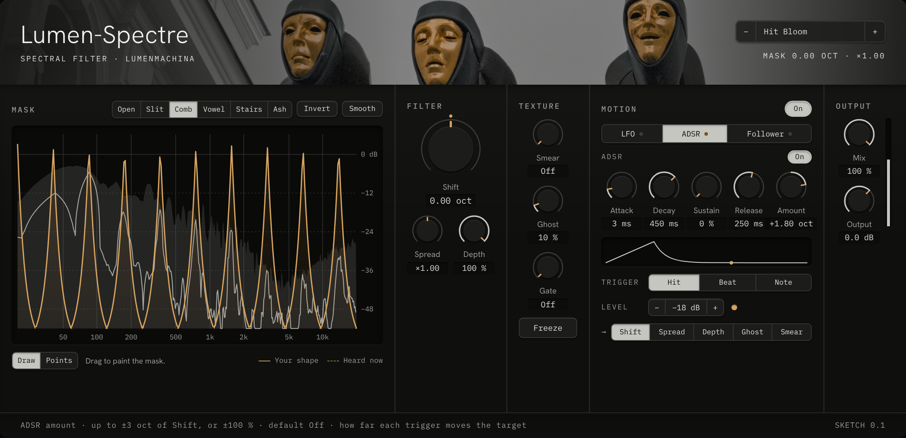
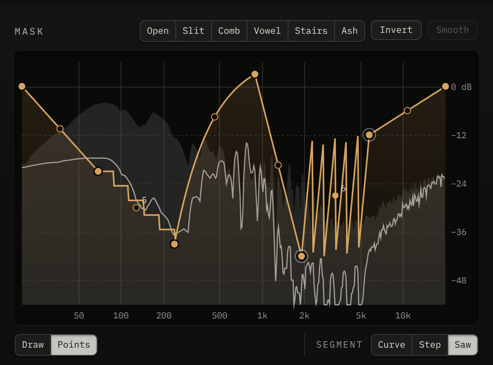

# Lumen-Spectre

**A spectral filter.** Lumen-Spectre splits sound into about a thousand thin frequency bands and sets the level of each one with the **Mask**, a curve you draw. Slide the Mask up and down the spectrum, stretch it, let the bands ring on or freeze them, scatter them into a whisper, and move it all with an LFO, an envelope or the sound itself. For combed and vowel-shaped pads, ghostly tails on drums, frozen chords and filters that move in ways an ordinary filter can't.

**In development.** Spectre is being shaped in a playable sketch now; the plugin comes next. Planned for **Bitwig Studio** (and any CLAP host) on Windows and Mac, and **Logic Pro** as an Audio Unit.

## The Mask

The Mask runs from 20 Hz to 20 kHz. Wherever it's high, sound passes; wherever it's low, it's cut; above 0 dB it boosts. Behind it you see the sound coming in and the sound going out.

There are two ways to make one:

- **Draw:** paint it with the pointer, as freely as you like.
- **Points:** click to place points and drag them around. Each stretch between two points is a **Curve** you can bend, a run of **Steps**, or a **Saw** of repeating teeth, and a small handle sets how far it bends or how many steps and teeth it has.

Start from a shape (Open, Slit, Comb, Vowel, Stairs or Ash), invert it, or smooth it.

## Filter and texture

- **Shift** slides the whole Mask up or down by up to four octaves. **Spread** squeezes or stretches it. **Depth** sets how hard it cuts and boosts.
- **Smear** lets each band ring on after the sound moves on, from a short blur to a six-second wash.
- **Ghost** scatters the bands' phase, for a breathy, whispered, hollow sound.
- **Gate** keeps only the loudest bands, thinning the sound down to its strongest notes.
- **Freeze** holds the spectrum as it is, as long as you like.

## Motion

Three sources can move Shift, Spread, Depth, Ghost or Smear:

- **LFO:** six shapes, from a smooth sine to slow random drift.
- **ADSR:** an envelope started by every drum hit or note attack, on every beat, or by MIDI notes you play.
- **Envelope follower:** the louder the sound, the further it moves.

While the Mask moves, the shape you made stays as a solid line and what you hear is drawn beside it, so you can keep editing. One switch turns all movement off, and back on, without losing any settings.

## Look

Spectre's look comes from a Lumen-Machina photograph of three black-robed statues with gold masks against a gray sky. The window is all matte black and stone gray, and gold is kept for what's alive: the Mask, the knob notches and anything that's moving.

## Getting it

Not available yet. It will be listed on [Gumroad](https://lumenmachina.gumroad.com) when it's released, like the other Lumen plugins.

Have an idea for it? [Open an issue](https://github.com/Lumen-Machina/Lumen-Suite/issues/new/choose) and choose Lumen-Spectre.

---

[← All Lumen plugins](../README.md)
